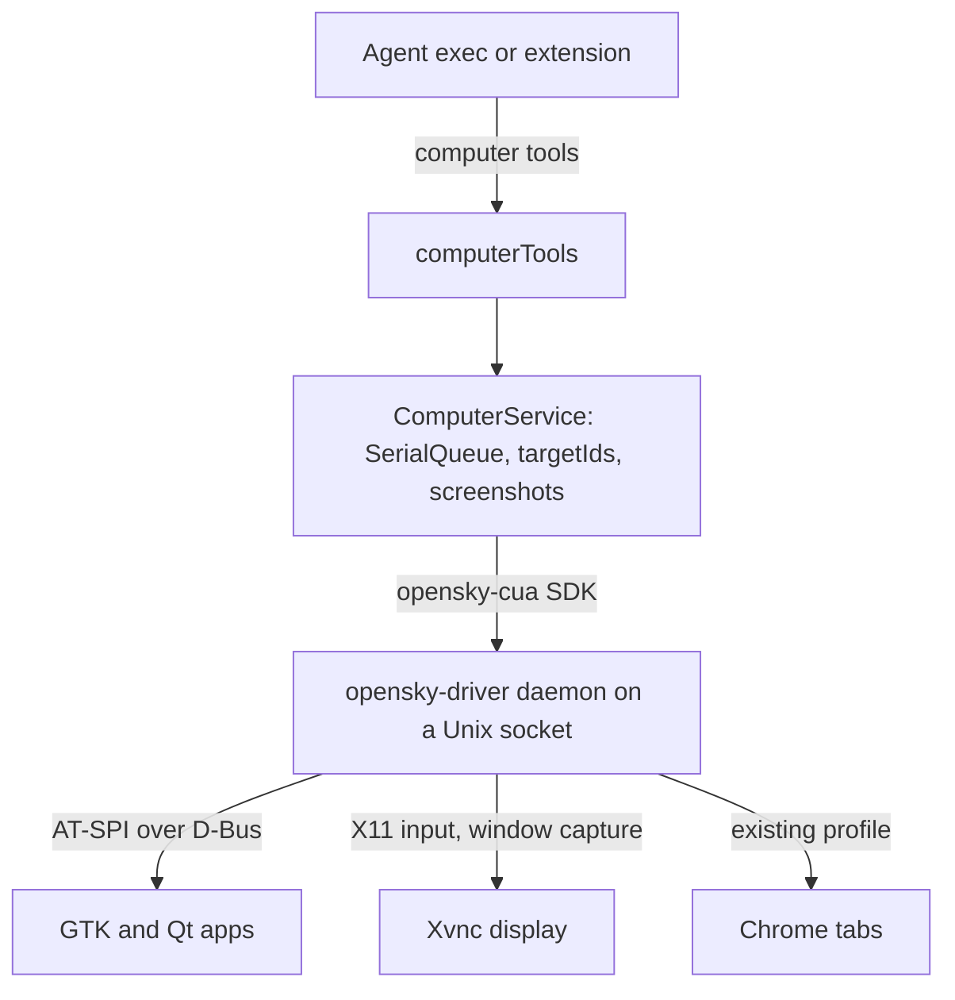

# agent-desktop vs. OpenSky

Research on whether Halo's computer tools should use [vercel-labs/agent-desktop](https://github.com/vercel-labs/agent-desktop) (v1.3.1, `8ffecc1`) in library mode instead of [OpenSky](https://github.com/tanishqkancharla/opensky). No code changes. Companion to [Halo's VM vs. wrapvm](halo-vm-vs-wrapvm.md).

## Answer

**No.** Don't replace OpenSky, and don't run both side by side.

- On Linux both read the same AT-SPI accessibility tree, so a swap gains no new perception.
- agent-desktop has no browser-tab API, and Halo's tools depend on one.
- Its library mode is a C ABI with no maintained Node binding. OpenSky is already a TypeScript SDK over a long-lived daemon, which matches [[packages/workspace-server/src/computer/ComputerService.ts#ComputerService]].
- agent-desktop is the more mature project, so copy its interaction rules instead.

## How Halo drives the desktop today



The driver is built from a pinned fork of trycua's `cua-driver` ([[apps/workspace-server/Dockerfile#L8-L20]]). Observation already returns the accessibility tree, with a screenshot only on request:

```callstack [observe]
 result = observe({targetId, screenshot}) [[packages/workspace-server/src/computer/ComputerService.ts#ComputerService.observe]]
 ├── if !screenshot: return { text: target.getAXState() }
 ├── obs = target.getAXStateAndScreenshot()
 ├── save PNG or JPEG to .halo/computer/images/
 └── return { text, screenshot: { path } }
```

## Comparison

| | OpenSky (today) | agent-desktop |
| --- | --- | --- |
| Shape | TS SDK plus Rust daemon on a socket | Rust core; CLI (one JSON envelope per command), MCP server, C library |
| Linux perception | AT-SPI tree with integer indices, plus window screenshots | AT-SPI JSON tree with refs tied to their snapshot (`@s8f3k2p9:e8`); separate `screenshot` |
| Input | AT-SPI actions, then X11 targeted input; foreground needs explicit opt-in | AT-SPI actions without moving the pointer; `--headed` allows physical input |
| Browser | Discover the user's tabs, create owned tabs, navigate, close only owned tabs | None. Tabs belong to sibling agent-browser (CDP). Chrome needs `--force-renderer-accessibility` |
| Surface | About a dozen methods on bound app and tab objects | 57 commands, including find, check/expand, window management, notifications, `wait`, skeleton snapshots, batch |
| Errors | `OpenSkyError` codes; Halo maps closed or missing targets to `ComputerTargetError` | `STALE_REF`, `AMBIGUOUS_TARGET`, and `error.disposition.retry: safe` |
| Linux floor | Validated on Halo's Debian 12 X11 desktop | Ubuntu 24.04 desktops (glibc 2.35 loader floor) |
| License, owner | MIT fork kept by Halo's author; GitHub release tarballs; Halo pins 0.2.30 while 0.2.47 is out | Apache-2.0, Vercel Labs; npm and Homebrew; 1.3.0 and 1.3.1 this week |

**Reliability.** Both depend on each app's AT-SPI bridge, so expect similar results on native apps. agent-desktop's stale-ref and ambiguous-window refusals help avoid wrong clicks. OpenSky's equivalents are opt-in foreground delivery, refusing captures it cannot attribute to a window, and closing only tabs it owns. OpenSky wins on browsers.

## What a swap would take

```mermaid diff [Swap to agent-desktop]
 flowchart LR
     T[computerTools] --> S[ComputerService]
-    S -->|opensky-cua| D[opensky-driver daemon]
-    D --> Apps[Apps via AT-SPI]
-    D --> C[Chrome tabs]
+    S -->|koffi FFI, CLI per call, or MCP child| AD[agent-desktop]
+    AD --> Apps[Apps via AT-SPI]
+    S -->|CDP via DevToolsActivePort| C[Chrome tabs, rebuilt]
```

- **Binding.** Three options: the C ABI through `koffi` (handles must stay on one thread, and `ffi-napi`, which the docs mention, is unmaintained); one CLI process per action; or a long-lived `agent-desktop mcp` child.
- **Tool schemas.** Integer indices become ref strings, and prompts must change to match.
- **Tabs.** Rebuild on CDP, and launch Chrome with `--force-renderer-accessibility`.
- **Base image.** Halo uses `node:22-bookworm` ([[apps/workspace-server/Dockerfile#L6]]). agent-desktop's 22.04 failure comes from an ATK bridge `GetActions` bug that at-spi2-core 2.52 fixed. Bookworm ships 2.46; whether it has the fix is unverified.
- **Removals.** Drop the driver build stage and daemon, then re-check paste, foreground input and capture on Xvnc with xfwm4 compositing ([[apps/workspace-server/desktop/start.sh#L59]]).

That is a large change that loses OpenSky's Halo-specific contracts and gains no new capability.

## What to take instead

- **Observation-scoped indices**, so a stale index fails instead of clicking the wrong control.
- **A retry flag on errors** (`safe` or `unsafe`). The paste tool's no-replay warning shows the need.
- **Skeleton then drill-down snapshots** for dense apps.
- **`wait` on a condition** after actions.
- **An offline benchmark:** run `agent-desktop snapshot` next to OpenSky on Halo's desktop image over a fixed set of apps, and compare tree completeness and action success.

## Open questions

- Will OpenSky stay Halo-owned long-term? If the plan is to depend on an outside driver, agent-desktop plus agent-browser is the strongest pair, and the base image question comes first.
- Does bookworm's at-spi2-core 2.46 include the `GetActions` fix?

## References

- Halo: [[packages/workspace-server/src/computer/ComputerService.ts]], [[packages/workspace-server/src/computer/computerTools.ts]], [[apps/workspace-server/Dockerfile]], [[apps/workspace-server/desktop/start.sh]]
- External: [agent-desktop README](https://github.com/vercel-labs/agent-desktop), [agent-desktop FFI](https://github.com/vercel-labs/agent-desktop/tree/main/crates/ffi), [Linux distribution checks](https://github.com/vercel-labs/agent-desktop/blob/main/tests/linux-dist/README.md), [OpenSky README](https://github.com/tanishqkancharla/opensky), [cua-driver Linux notes](https://github.com/tanishqkancharla/cua/blob/main/libs/cua-driver/rust/Skills/cua-driver/LINUX.md)
