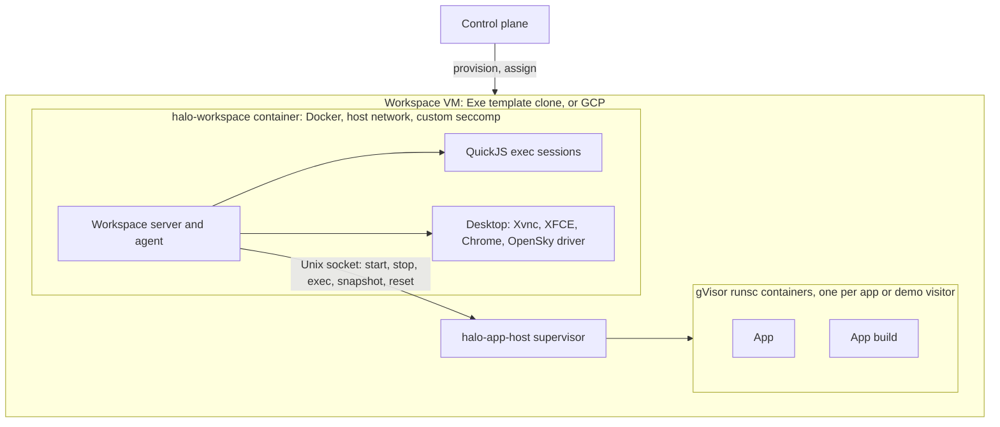
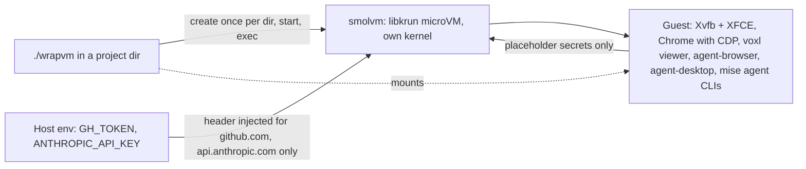

# Halo's VM vs. wrapvm

Research comparing Halo's sandboxing layers with [tobi/wrapvm](https://github.com/tobi/wrapvm) (`41e3b0b`, Nov 3, 2026) and [smolvm](https://github.com/smol-machines/smolvm), the runtime it boots on. No code changes.

## Recommendation

Do not adopt wrapvm. It is about 3,500 lines of packaging: one Containerfile for a Linux desktop, one Smolfile, and a 49-line launcher. Halo already ships nearly the same desktop, and its version has the per-user authentication that wrapvm does not need. Two ideas are worth taking, both from smolvm rather than from wrapvm's image:

1. **Swap in credentials at the boundary.** The guest sees a placeholder secret, and the host adds the real header only on requests to named hosts. This answers the open TODO, "Remove workspace VM access to the OpenAI API key" ([[TODO.md#L6]]). A proxy on the workspace host can do this without smolvm.
2. **Per-app microVMs with checkpoints and copy-on-write branches**, as a later option for the app sandbox. See [microVM app sandbox](#microvm-app-sandbox).

Smaller items: agent-desktop's interaction rules (see [agent-desktop vs. OpenSky](agent-desktop-vs-opensky.md)), a PulseAudio null sink if desktop audio is ever needed, and container-level desktop tests in CI.

## What "Halo's VM" is

Halo nests four isolation layers, each sized to how much it trusts the code inside.



| Layer | Isolation | Limits |
| --- | --- | --- |
| Workspace VM | One VM per user. Exe in production: the control plane clones a template VM, then pauses and resumes it ([[apps/control-plane/src/workspace/provider/exe/ExeApi.ts#L61]]) | VM size |
| Workspace container | Docker, non-root, Moby default seccomp plus `clone`/`setns`/`unshare` so Chrome can sandbox itself | None beyond the VM |
| App sandbox | gVisor (`runsc`, systrap), read-only root, `cap-drop=ALL`, private ranges and app-to-app traffic blocked ([[infra/workspace/appSandboxSetup.sh#L40-L49]]) | 256 MB / 0.5 CPU per app, 512 MB / 1 CPU per build, 768 MB / 1 CPU for all apps together |
| Exec sessions | QuickJS compiled to WASM in a Node worker; guest code sees only tool calls | 32 MB heap, 1 MB stack, 2 s per job ([[packages/workspace-server/src/agent/runtime/codeExecutor.worker.ts#L24-L38]]) |

## What wrapvm is

wrapvm is "a desktop VM for agents": tobi/wrap's desktop image with additions, published as `ghcr.io/tobi/wrapvm:desktop`.



smolvm boots in under a second, uses balloon memory, and can checkpoint a running machine, branch it copy-on-write, pause it, and pack it into one file. wrapvm uses none of the checkpoint or branch features.

## Comparison

| | Halo | wrapvm |
| --- | --- | --- |
| Purpose | Hosted, many users; apps shared with other people; agent code mode | One developer's local agent desktop |
| Boundary | Cloud VM, then Docker; apps in gVisor; agent JS in QuickJS | One microVM per directory, or one container |
| Network | Host networking for the workspace; strict per-app rules | Internet open; LAN, loopback, metadata and CGNAT blocked |
| Secrets | Workspace still holds the OpenAI key | Placeholder in guest; host injects the real header |
| Viewer | noVNC on loopback, behind workspace auth, in a Halo pane | voxl, password plus loopback publish, with audio |
| Agent control | OpenSky: AT-SPI tree plus optional screenshots, Chrome tabs | agent-browser (CDP), agent-desktop (AT-SPI) |
| DX | Internal APIs: provider interface, `AppSandbox`, `WorkerCodeExecutor.evaluate` | `./wrapvm`, Smolfile, `docker run` |
| Footprint | Desktop spike measured about 961 MiB with Chrome open | 4 vCPU / 8 GB ceiling, balloon memory |
| Tests | Workspace server unit and E2E; desktop checked by hand | Six container test scripts in CI |

Not worth adopting: wrapvm's image (Arch-based; CDP exposed on guest interfaces, which Halo deliberately keeps on loopback; a password viewer instead of Halo's gateway), one VM per directory (Halo already has one VM per user), or VMs for exec sessions (QuickJS is far lighter, and agent code needs no OS).

## microVM app sandbox

**Today.** Each app start is a fresh `docker run --runtime=runsc` of Node, followed by up to 30 s of readiness polling (120 s while installing). Startup work is never reused. Each demo visitor gets a new container with sample data copied in. `snapshot` exports only `tandem.json`, never process state. gVisor cannot reach Docker's DNS, so apps get hard-coded resolvers ([[infra/workspace/appSandboxSetup.sh#L58]]).

```callstack [App start today]
 result = start(body) [[infra/workspace/appHost.py#L214-L234]]
 ├── refuse if 4 apps already running [[infra/workspace/appHost.py#L226]]
 ├── data = volume(dir, 128M, or 32M for a demo visitor) [[infra/workspace/appHost.py#L230]]
 ├── import_data(sample tandem.json) [[infra/workspace/appHost.py#L174-L198]]
 └── return run_app(...) [[infra/workspace/appHost.py#L237-L301]]
     ├── docker run --runtime=runsc ... node dist/start.mjs
     └── poll /__halo/ready for up to 30 s, or 120 s while installing [[infra/workspace/appHost.py#L278]]
```

**What smolvm could change.** Boot an app once, freeze it when it is ready, and give each visitor a copy-on-write branch with Node already listening. A "snapshot" could capture memory and CPU state as well as data. An agent could branch a running app before a risky build and throw the branch away if it fails. Allow-lists and credential swapping would replace the hand-written iptables and resolver workarounds.

```mermaid diff [Demo visitor start]
 flowchart LR
     V[Visitor opens demo] --> S[halo-app-host]
-    S --> C[docker run runsc: cold Node start]
-    C --> R[Poll /__halo/ready]
+    S --> B[Lease a branch from a warm pool]
+    B --> F[Frozen app VM, already listening]
```

**Costs.**
- Shared-app sandboxes already run inside a VM, so smolvm needs nested KVM. Nested guests are "much slower than first-level ones" (smolvm docs). GCP allows nested virtualization on some Intel machine types; whether Exe does is unknown, and that settles it.
- Each app would add a guest kernel and a VMM process, inside a 768 MB budget for four apps.
- A hardware boundary is not automatically stronger than gVisor: libkrun runs its virtio devices in the host process.
- smolvm is pre-1.0.

**Cheaper options to try first:** gVisor's own checkpoint and restore (`runsc checkpoint` / `restore`), or a small pool of pre-started containers per published app.

**Experiment:** (1) check `/dev/kvm` and nested KVM on an Exe and a GCP shared-app VM, and stop if neither has them; (2) for one published app, compare cold runsc start, runsc restore, smolvm cold boot, and a smolvm branch, by time to `/__halo/ready` and host memory with 1, 4 and 20 demo visitors; (3) adopt only if branches clearly beat both cheaper options.

## Open questions

- Should local Electron workspaces ever run inside a VM? If not, smolvm barely matters to Halo.
- Do Exe VMs expose `/dev/kvm`?

## References

- Halo: [[infra/workspace/appHost.py]], [[infra/workspace/appSandboxSetup.sh]], [[packages/workspace-server/src/extensions/AppSandbox.ts#AppSandbox]], [[packages/workspace-server/src/agent/runtime/codeExecutor.worker.ts]], [[apps/workspace-server/desktop/README.md]], [[infra/workspace/exeTemplate.sh]]
- External: [tobi/wrapvm](https://github.com/tobi/wrapvm), [smolvm README](https://github.com/smol-machines/smolvm), [smolvm branching](https://github.com/smol-machines/smolvm/blob/main/docs/branching.md), [smolvm nested virtualization](https://github.com/smol-machines/smolvm/blob/main/docs/nested-virtualization.md)
