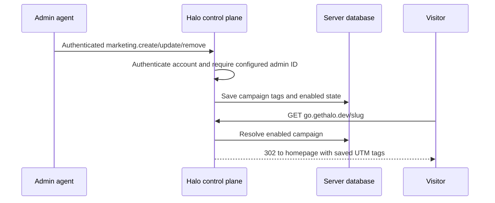
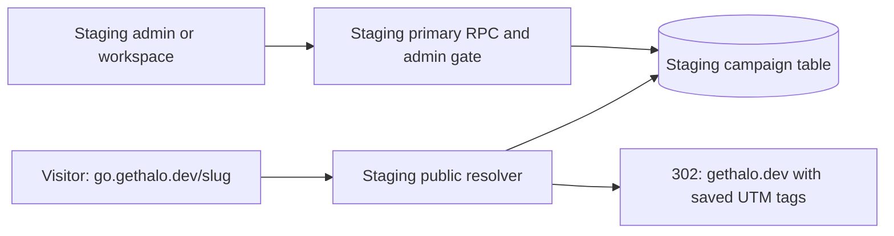

# Persistent marketing campaigns

Campaigns belong to Halo's normal control plane. Agents must manage them without
editing deployment configuration, and visitors must always land on the homepage.
PRs #553 and #554 supply direct host routing and existing wildcard ingress/TLS;
the superseded extension HTTP/custom-domain PRs #543–545 are closed unmerged.

The control plane owns one campaign table in its existing server database. An
explicit deployment-configured set of Halo user IDs authorizes management. No
configured administrators means no management access. Browser sessions use the
primary origin; workspace agents authenticate through their owner's runtime.



Goals: persistent campaign CRUD, server-enforced admin authorization, immediate
updates and disabled links, homepage-only redirects, and agent API documentation.
No management UI, custom domain registry, extension handler, arbitrary destination
URL, click analytics database, or new authentication credentials are introduced.
The existing landing page owns Google Analytics and conversion attribution.

## ✅ Phase 1: Campaign database and admin API

**Today:** Campaigns are deployment configuration. Changing a link needs a rollout.

**Proposed:** Add `marketing.create/list/update/remove` on the normal control-plane
RPC surface. Store a unique slug, five UTM fields and enabled state. Borrow the
same SQL owner/transaction queue as app storage rather than opening another
connection or maintaining a second queue. PostgreSQL and SQLite use the same SQL.
The public resolver remains configured until phase 2 connects the database.

```callstack
 Admin agent
 └── controlPlaneRpcRouter
+    ├── authenticated account or owner workspace identity
+    └── MarketingLinks [[campaign-store:new:49-60]] # explicit admin ID authorization before each operation
+        └── DatabaseService.appDatabase # shared SQL queue and connection
```

## ✅ Phase 2: Resolve persistent campaigns

**Today:** The go hostname reads a static map of slug-to-UTM tags.

**Proposed:** Query enabled campaigns on each GET/HEAD. Return 404 for missing or
disabled links, 405 for other methods and 500 on database failure. Preserve raw
path validation, ignore visitor target/tag overrides and prevent private routes
or WebSockets on the marketing host. Remove campaign-map configuration from the
server and Pulumi; only the administrator list remains deployment configuration.
No live links exist in the supplied production map, so no data import is needed.

```callstack
 Visitor
 └── controlPlaneHttp # reserved go host, no private Halo routes
+    └── serveMarketingLink [[campaign-routing:new:23-28]]
+        ├── MarketingLinks.resolve # SQL enabled campaign lookup
+        └── 302 to homepage with saved tags
```

Validation: all 84 control-plane tests and all 57 affected checks pass in layer 1.
SQLite reopen tests preserve campaign data and disabled state; a real PostgreSQL
replica test verifies shared writes, atomic duplicate rejection and immediate
visibility. Phase 2 also exercises live HTTP behavior when the database is closed.
No deployment or DNS changes are performed; staging ingress/TLS remains to verify.

## ✅ Phase 3: Staging owns the production marketing hostname

**Today:** Each deployment derives its marketing host and homepage from its primary
origin. Staging accounts therefore manage staging URLs only.

**Proposed:** Configure the marketing hostname and homepage independently of the
primary origin. Staging owns `go.gethalo.dev`, reads its own persistent campaigns,
and redirects visitors to `https://gethalo.dev/`. Staging account and workspace
credentials still authenticate at `staging.gethalo.dev`; only configured staging
administrators can modify campaigns. A dedicated load-balancer certificate covers
the production marketing hostname without changing staging's main certificate.

```callstack
 Visitor: GET go.gethalo.dev/slug
 └── staging load balancer # dedicated certificate and exact host map
+    └── controlPlaneHttp [[staging-routing:new:192-194]] # configured marketing hostname
+        └── serveMarketingLink [[staging-routing:new:234]] # production homepage origin
             └── MarketingLinks.resolve # staging database, enabled records only
```



The canonical HTTP test creates a campaign through a staging administrator's real
workspace runtime and resolves it on the production marketing hostname. It also
checks primary sign-in, private-route and WebSocket isolation, Host ports, visitor
query overrides and immediate disabling. Config tests cover local/cloud bootstrap
and malformed overrides. A real `west` Pulumi preview succeeds and exports
`A go.gethalo.dev → 34.54.19.173`; it also shows unrelated existing image/template
drift, which must be reviewed before deployment. Deploy first, replace `go` DNS,
then wait for the load-balancer-authorized certificate to activate. No deployment,
DNS change or administrator grant is performed by this work.

## ✅ Phase 4: Private administrator IDs in Secret Manager

**Today:** Pulumi takes an administrator ID array and writes its JSON value into
Cloud Run environment configuration. Putting real IDs in stack YAML exposes them
in the public repository.

**Proposed:** Keep only `marketingAdminUserIdsSecretId` in Pulumi and grant the
control-plane runtime read access to that specific secret. At startup, the normal
config loader reads its latest JSON-array version through the existing Secret
Manager adapter. The server keeps the same admin authorization behavior and
campaign database. Secret values never pass through Pulumi or Git.

```callstack
 Staging deployment: configure secret name only
+└── SecretIamMember # runtime read access on that secret
     └── Control-plane startup
+        └── readMarketingAdminUserIds [[private-admins:new:381-387]]
             ├── Secret Manager latest version # private JSON IDs; failure stops startup
             └── Existing schema and MarketingLinks admin gate
```

The public west config names `halo-west-marketing-admin-user-ids`; an operator
creates its first private version before deployment. Config tests cover local
and cloud startup, replacement/revocation on restart, secret precedence, access
failures and invalid payloads. A new version requires a rollout to reload all
instances. No live secret, administrator grant or running service is changed here.
The direct JSON environment option remains available for private local development.

## References

- [[apps/control-plane/src/marketing/MarketingLinks.ts]]
- [[apps/control-plane/src/marketing/serveMarketingLink.ts]]
- [[apps/control-plane/src/server/controlPlaneRpcRouter.ts]]
- [[packages/shared/src/marketingCampaign.ts]]
- [[apps/control-plane/README.marketing-links.md]]

## Phase 1 source patch

```source-diff:campaign-store:apps/control-plane/src/marketing/MarketingLinks.ts
diff --git a/apps/control-plane/src/marketing/MarketingLinks.ts b/apps/control-plane/src/marketing/MarketingLinks.ts
new file mode 100644
index 00000000..6a628d37
--- /dev/null
+++ b/apps/control-plane/src/marketing/MarketingLinks.ts
@@ -0,0 +1,141 @@
+// oxlint-disable unicorn/no-null -- SQL rows and bindings represent missing optional tags with NULL.
+import type { MarketingCampaign } from "@get-halo/shared/marketingCampaign";
+import * as errore from "errore";
+import type { SqlDatabase } from "../database/SqlDatabase.js";
+
+export class MarketingAdminRequiredError extends errore.createTaggedError({
+  name: "MarketingAdminRequiredError",
+  message: "Marketing links require Halo administrator access.",
+}) {}
+export class MarketingLinkConflictError extends errore.createTaggedError({
+  name: "MarketingLinkConflictError",
+  message: "This marketing slug is already in use. Choose another slug.",
+}) {}
+export class MarketingLinkNotFoundError extends errore.createTaggedError({
+  name: "MarketingLinkNotFoundError",
+  message: "Marketing link not found. List the links to check the slug.",
+}) {}
+
+type CampaignRow = {
+  slug: string;
+  utm_source: string;
+  utm_medium: string;
+  utm_campaign: string;
+  utm_content: string | null;
+  utm_term: string | null;
+  enabled: number;
+};
+
+/** Server-owned campaigns; public resolution never receives admin authority. */
+export class MarketingLinks {
+  private readonly database: SqlDatabase;
+  private readonly adminUserIds: ReadonlySet<string>;
+
+  constructor(ctx: { database: SqlDatabase; adminUserIds: string[] }) {
+    this.database = ctx.database;
+    this.adminUserIds = new Set(ctx.adminUserIds);
+  }
+
+  async initialize() {
+    return await this.database
+      .query(`CREATE TABLE IF NOT EXISTS marketing_links (
+      slug TEXT PRIMARY KEY, utm_source TEXT NOT NULL, utm_medium TEXT NOT NULL,
+      utm_campaign TEXT NOT NULL, utm_content TEXT, utm_term TEXT,
+      enabled INTEGER NOT NULL DEFAULT 1 CHECK (enabled IN (0,1)))`);
+  }
+
+  async create(input: {
+    ownerUserId: string;
+    slug: string;
+    tags: MarketingCampaign["tags"];
+  }) {
+    if (!this.adminUserIds.has(input.ownerUserId))
+      return new MarketingAdminRequiredError();
+    const { slug, tags } = input;
+    const rows = await this.database.query<CampaignRow>(
+      `INSERT INTO marketing_links
+      (slug, utm_source, utm_medium, utm_campaign, utm_content, utm_term, enabled)
+      VALUES ($1,$2,$3,$4,$5,$6,1) ON CONFLICT (slug) DO NOTHING RETURNING *`,
+      // SQL bindings represent optional campaign fields with NULL.
+      // oxlint-disable-next-line unicorn/no-null
+      [
+        slug,
+        tags.utm_source,
+        tags.utm_medium,
+        tags.utm_campaign,
+        tags.utm_content ?? null,
+        tags.utm_term ?? null,
+      ],
+    );
+    if (rows instanceof Error) return rows;
+    if (rows[0] === undefined) return new MarketingLinkConflictError();
+    return campaign(rows[0]);
+  }
+
+  async list(ownerUserId: string) {
+    if (!this.adminUserIds.has(ownerUserId))
+      return new MarketingAdminRequiredError();
+    const rows = await this.database.query<CampaignRow>(
+      "SELECT * FROM marketing_links ORDER BY slug",
+    );
+    if (rows instanceof Error) return rows;
+    return rows.map(campaign);
+  }
+
+  async update(input: MarketingCampaign & { ownerUserId: string }) {
+    if (!this.adminUserIds.has(input.ownerUserId))
+      return new MarketingAdminRequiredError();
+    const { slug, tags, enabled } = input;
+    const rows = await this.database.query<CampaignRow>(
+      `UPDATE marketing_links SET utm_source=$2, utm_medium=$3, utm_campaign=$4,
+      utm_content=$5, utm_term=$6, enabled=$7 WHERE slug=$1 RETURNING *`,
+      // oxlint-disable-next-line unicorn/no-null -- SQL bindings represent missing optional tags with NULL.
+      [
+        slug,
+        tags.utm_source,
+        tags.utm_medium,
+        tags.utm_campaign,
+        tags.utm_content ?? null,
+        tags.utm_term ?? null,
+        enabled ? 1 : 0,
+      ],
+    );
+    if (rows instanceof Error) return rows;
+    if (rows[0] === undefined) return new MarketingLinkNotFoundError();
+    return campaign(rows[0]);
+  }
+
+  async remove(input: { ownerUserId: string; slug: string }) {
+    if (!this.adminUserIds.has(input.ownerUserId))
+      return new MarketingAdminRequiredError();
+    const rows = await this.database.query<{ slug: string }>(
+      "DELETE FROM marketing_links WHERE slug=$1 RETURNING slug",
+      [input.slug],
+    );
+    if (rows instanceof Error) return rows;
+    if (rows.length === 0) return new MarketingLinkNotFoundError();
+  }
+
+  async resolve(slug: string) {
+    const rows = await this.database.query<CampaignRow>(
+      "SELECT * FROM marketing_links WHERE slug=$1 AND enabled=1",
+      [slug],
+    );
+    if (rows instanceof Error) return rows;
+    return rows[0] === undefined ? undefined : campaign(rows[0]).tags;
+  }
+}
+
+function campaign(row: CampaignRow): MarketingCampaign {
+  return {
+    slug: row.slug,
+    tags: {
+      utm_source: row.utm_source,
+      utm_medium: row.utm_medium,
+      utm_campaign: row.utm_campaign,
+      utm_content: row.utm_content ?? undefined,
+      utm_term: row.utm_term ?? undefined,
+    },
+    enabled: row.enabled === 1,
+  };
+}
```

## Phase 2 source patch

```source-diff:campaign-routing:apps/control-plane/src/marketing/serveMarketingLink.ts
diff --git a/apps/control-plane/src/marketing/serveMarketingLink.ts b/apps/control-plane/src/marketing/serveMarketingLink.ts
index f363cc6b..7053a351 100644
--- a/apps/control-plane/src/marketing/serveMarketingLink.ts
+++ b/apps/control-plane/src/marketing/serveMarketingLink.ts
@@ -1 +1 @@
-import type { ControlPlaneConfig } from "@get-halo/config/controlPlane";
+import type { MarketingLinks } from "./MarketingLinks.js";
@@ -4,2 +4,2 @@ import type { IncomingMessage, ServerResponse } from "node:http";
-/** Resolve only configured slugs to Halo's homepage; no visitor-supplied target. */
-export function serveMarketingLink(ctx: {
+/** Resolve only enabled saved slugs to Halo's homepage; no visitor-supplied target. */
+export async function serveMarketingLink(ctx: {
@@ -9 +9 @@ export function serveMarketingLink(ctx: {
-  links: ControlPlaneConfig["marketingLinks"];
+  links: Pick<MarketingLinks, "resolve">;
@@ -23,4 +23,6 @@ export function serveMarketingLink(ctx: {
-  const tags =
-    slug !== undefined && links !== undefined && Object.hasOwn(links, slug)
-      ? links[slug]
-      : undefined;
+  const tags = slug === undefined ? undefined : await links.resolve(slug);
+  if (tags instanceof Error) {
+    console.error(tags);
+    response.writeHead(500).end();
+    return;
+  }
```

## Phase 3 source patch

```source-diff:staging-routing:apps/control-plane/src/server/controlPlaneHttp.ts
diff --git a/apps/control-plane/src/server/controlPlaneHttp.ts b/apps/control-plane/src/server/controlPlaneHttp.ts
index 2b8f6d4c..1091077d 100644
--- a/apps/control-plane/src/server/controlPlaneHttp.ts
+++ b/apps/control-plane/src/server/controlPlaneHttp.ts
@@ -171,0 +172,2 @@ export function serveControlPlaneHttp(ctx: {
+  marketingHostname?: string;
+  marketingHomepageOrigin?: string;
@@ -190,3 +192,3 @@ export function serveControlPlaneHttp(ctx: {
-  const marketingHostname = new URL(
-    creatorOrigin({ publicOrigin, handle: "go" }),
-  ).hostname;
+  const marketingHostname =
+    ctx.marketingHostname ??
+    new URL(creatorOrigin({ publicOrigin, handle: "go" })).hostname;
@@ -232 +234 @@ export function serveControlPlaneHttp(ctx: {
-        publicOrigin,
+        homepageOrigin: ctx.marketingHomepageOrigin ?? publicOrigin,
```

## Phase 4 source patch

```source-diff:private-admins:packages/config/src/controlPlane.ts
diff --git a/packages/config/src/controlPlane.ts b/packages/config/src/controlPlane.ts
index 4a31b24a..1b106d4c 100644
--- a/packages/config/src/controlPlane.ts
+++ b/packages/config/src/controlPlane.ts
@@ -232 +232 @@ async function readDevelopmentConfig(): Promise<ControlPlaneConfig | Error> {
-  const marketingAdminUserIds = readMarketingAdminUserIds();
+  const marketingAdminUserIds = await readMarketingAdminUserIds();
@@ -297 +297 @@ async function readCloudRunConfig(): Promise<ControlPlaneConfig | Error> {
-  const marketingAdminUserIds = readMarketingAdminUserIds();
+  const marketingAdminUserIds = await readMarketingAdminUserIds();
@@ -381,2 +381,7 @@ export async function readControlPlaneSecret(secretId: string) {
-function readMarketingAdminUserIds() {
-  const raw = process.env.HALO_MARKETING_ADMIN_USER_IDS;
+async function readMarketingAdminUserIds() {
+  const secretId = process.env.HALO_MARKETING_ADMIN_USER_IDS_SECRET_ID;
+  const raw =
+    secretId === undefined
+      ? process.env.HALO_MARKETING_ADMIN_USER_IDS
+      : await readControlPlaneSecret(secretId);
+  if (raw instanceof Error) return raw;
```
