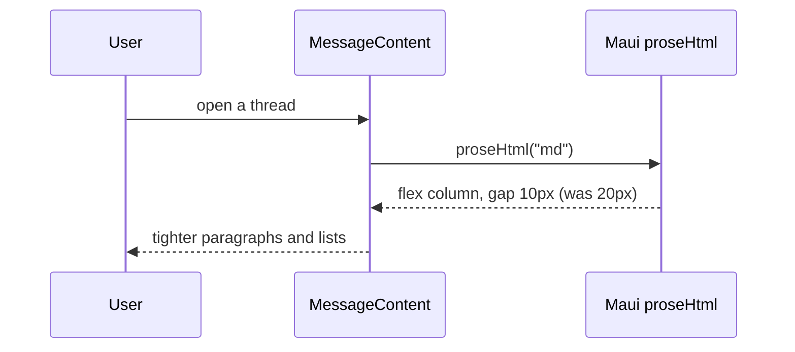

# Update Maui 0.0.67 → 0.0.72

Compared **`main` (c72c51e4, Maui 0.0.67) → `cursor/maui-0-0-72-057d` (5d035e59, Maui 0.0.72)**. The change is committed on the branch and not merged. Halo's own source does not change; the Maui package changes under it. The call stacks below are source-checked, not recorded traces. `-` marks removed steps, `+` added steps.

```changes
5d035e59
packages/web/package.json
apps/electron/package.json
packages/workspace-server/package.json
pnpm-workspace.yaml
patches/@tanishqkancharla__maui@0.0.72.patch
pnpm-lock.yaml
packages/extension-tools/src/scaffold.ts
apps/electron/e2e/e2eTest.ts
skills-lock.json
```

## Problem

Halo pinned Maui 0.0.67 in the web package, the Electron app, and the workspace server. New extensions and the E2E extension fixture still pinned 0.0.66. Five Maui releases had shipped since, with design fixes Halo did not have: a text button, editor heading rhythm, steady paragraph gaps, and readable selected-item colors. The workspace Maui skill that agents read also described 0.0.66.

## Solution

Every Maui pin now names 0.0.72. The repo's Maui skill is a copy of the one in the 0.0.72 package, and `skills-lock.json` carries its new hash. Halo keeps its one local patch, which forces tooltips to unmount when the browser skips `transitionend`. 0.0.72 leaves `Tooltip` alone, so the patch applies unchanged under a new file name and keeps the same patch hash.

```mermaid diff
flowchart LR
  web["@get-halo/web"]
  electron["@get-halo/desktop"]
  server["@get-halo/workspace-server"]
  ext["New extensions + E2E fixture"]
- m67["maui 0.0.67 + tooltip patch"]
- m66["maui 0.0.66"]
+ m72["maui 0.0.72 + tooltip patch"]
- web --> m67
- electron --> m67
- server --> m67
- ext --> m66
+ web --> m72
+ electron --> m72
+ server --> m72
+ ext --> m72
  %% ref node:web [[5d035e59:packages/web/package.json#L44]]
  %% ref node:electron [[5d035e59:apps/electron/package.json#L44]]
  %% ref node:server [[5d035e59:packages/workspace-server/package.json#L58]]
  %% ref node:ext [[5d035e59:packages/extension-tools/src/scaffold.ts#L38]] [[5d035e59:apps/electron/e2e/e2eTest.ts#L285]]
  %% ref node:m72 [[5d035e59:pnpm-workspace.yaml#L83]] [[5d035e59:pnpm-workspace.yaml#L102]]
```

No Halo code needed changes: the only API changes are additive (a new `"text"` `ButtonVariant` and an optional `selector` argument on `proseRhythm`). Everything else is styling, which shows up in the chapters below.

## User flows

### Read an assistant reply



### Write in the composer or a Markdown file

```mermaid
sequenceDiagram
  participant User
  participant Editor as Halo Editor
  participant MauiEditor as Maui Editor
  User->>Editor: type a heading, then a paragraph
  Editor->>MauiEditor: render ProseMirror surface
  MauiEditor-->>User: heading hugs the next block; paragraphs 10px apart
  %% ref node:Editor [[packages/web/src/main/agent/Editor.tsx#Editor]]
```

## Goals

- Halo, its workspace server, new extensions, and the E2E fixture resolve one Maui version, 0.0.72.
- The tooltip patch still applies.
- Agents read the 0.0.72 Maui skill.

Out of scope:

- Using the new `text` button variant anywhere in Halo.
- Retuning Halo screens for the tighter prose rhythm.

## Chat replies and Markdown panes use a 10px paragraph gap

The PR description has a before-and-after screenshot of the same thread in the packaged Electron app: the reply above uses `MessageContent` and the composer below uses the Maui `Editor`.

```callstack
 MessageContent  # chat replies and user bubbles [[packages/web/src/main/agent/MessageContent.tsx#MessageContent]]
 └── useStyles(proseHtml(size), streamdownRootClass)
     └── proseHtml  # Maui token
-        └── gap: blockGaps[size]  # 16 / 20 / 24px for sm / md / lg; 12 / 16 / 20px on touch
+        └── gap: blockGap  # 10px at every size and scale
```

`proseHtml` sets the gap between blocks in rendered Markdown. Maui dropped the per-size `blockGaps` variables and uses one 10px gap. Halo's chat uses size `md`, so its paragraph gap halves from 20px to 10px. List indents also shrink by 2px. Heading margins stay the same, so sections still separate. `Prose` containers in `FilePane`, `LandingPage`, `ConnectionPage`, `Authentication`, and `IntegrationSetupPage` get the same `proseRhythm` gap.

```diff:maui/src/tokens/prose.ts
--- a/src/tokens/prose.ts
+++ b/src/tokens/prose.ts
@@ -11,15 +11,15 @@
  * rhythm tuned for sustained reading. The `Prose` container picks a size and
  * typography components inside it opt into the matching prose treatment.
  *
- * Sizes and spacing are ported from the Tailwind Typography plugin
+ * Type sizes and heading spacing are ported from the Tailwind Typography plugin
  * (https://github.com/tailwindlabs/tailwindcss-typography): `sm` -> 14px base,
  * `md` -> Tailwind's `base` (16px), `lg` -> 18px. Tailwind's em-relative values
  * are resolved to px here so they compose with Maui's px-based tokens.
  *
  * On the Large platform scale (coarse pointers) block font sizes and line
  * heights step up ~1.2x — the same idea as the `text` tokens — so reading
- * content grows with the rest of the UI on touch devices. Block gaps tighten
- * separately (see `blockGaps`).
+ * content grows with the rest of the UI on touch devices. Paragraph gaps stay
+ * at 10px on both scales.
  */
 export type ProseSize = "sm" | "md" | "lg"
 
@@ -37,7 +37,6 @@
 }
 
 type ProseMetric = {
-	blockGap: number
 	paragraph: BlockMetric
 	h1: HeadingMetric
 	h2: HeadingMetric
@@ -55,7 +54,6 @@
 
 const metrics: Record<ProseSize, ProseMetric> = {
 	sm: {
-		blockGap: 16,
 		paragraph: { fontSize: scaledPx(14, 17), lineHeight: scaledPx(24, 29) },
 		h1: {
 			fontSize: scaledPx(30, 36),
@@ -81,11 +79,10 @@
 			marginTop: 20,
 			marginBottom: 8,
 		},
-		listPadding: 22,
+		listPadding: 20,
 		listItemGap: 4,
 	},
 	md: {
-		blockGap: 20,
 		paragraph: { fontSize: scaledPx(16, 19), lineHeight: scaledPx(28, 34) },
 		h1: {
 			fontSize: scaledPx(36, 43),
@@ -111,11 +108,10 @@
 			marginTop: 24,
 			marginBottom: 8,
 		},
-		listPadding: 26,
+		listPadding: 24,
 		listItemGap: 8,
 	},
 	lg: {
-		blockGap: 24,
 		paragraph: { fontSize: scaledPx(18, 22), lineHeight: scaledPx(32, 38) },
 		h1: {
 			fontSize: scaledPx(48, 58),
@@ -141,17 +137,12 @@
 			marginTop: 32,
 			marginBottom: 8,
 		},
-		listPadding: 28,
+		listPadding: 26,
 		listItemGap: 12,
 	},
 }
 
-// Slightly tighter reading rhythm on the Large platform scale.
-const blockGaps = defineVars({
-	sm: { default: `${metrics.sm.blockGap}px`, [LARGE_SCALE]: "12px" },
-	md: { default: `${metrics.md.blockGap}px`, [LARGE_SCALE]: "16px" },
-	lg: { default: `${metrics.lg.blockGap}px`, [LARGE_SCALE]: "20px" },
-})
+const blockGap = "10px"
 
 // Heading weights follow Tailwind's descending scale, capped at Maui's
 // heaviest weight (700).
@@ -216,24 +207,24 @@
  * `marginBottom` becomes the "hug" gap after a heading; heading `marginTop`
  * becomes the larger break before it.
  */
-export const proseRhythm = memoize((size: ProseSize) => {
+export const proseRhythm = memoize((size: ProseSize, selector = "&") => {
 	const m = metrics[size]
 
 	return style({
-		"& > * + *": {
-			marginTop: blockGaps[size],
+		[`${selector} > * + *`]: {
+			marginTop: blockGap,
 		},
 		// Gap after a heading: hug it to the content that follows.
-		"& > h1 + *": { marginTop: px(m.h1.marginBottom) },
-		"& > h2 + *": { marginTop: px(m.h2.marginBottom) },
-		"& > h3 + *": { marginTop: px(m.h3.marginBottom) },
-		"& > h4 + *": { marginTop: px(m.h4.marginBottom) },
+		[`${selector} > h1 + *`]: { marginTop: px(m.h1.marginBottom) },
+		[`${selector} > h2 + *`]: { marginTop: px(m.h2.marginBottom) },
+		[`${selector} > h3 + *`]: { marginTop: px(m.h3.marginBottom) },
+		[`${selector} > h4 + *`]: { marginTop: px(m.h4.marginBottom) },
 		// Break before a heading (only when it opens a new section, i.e. it
 		// isn't already hugging a preceding heading).
-		[`& > ${notHeading} + h1`]: { marginTop: px(m.h1.marginTop) },
-		[`& > ${notHeading} + h2`]: { marginTop: px(m.h2.marginTop) },
-		[`& > ${notHeading} + h3`]: { marginTop: px(m.h3.marginTop) },
-		[`& > ${notHeading} + h4`]: { marginTop: px(m.h4.marginTop) },
+		[`${selector} > ${notHeading} + h1`]: { marginTop: px(m.h1.marginTop) },
+		[`${selector} > ${notHeading} + h2`]: { marginTop: px(m.h2.marginTop) },
+		[`${selector} > ${notHeading} + h3`]: { marginTop: px(m.h3.marginTop) },
+		[`${selector} > ${notHeading} + h4`]: { marginTop: px(m.h4.marginTop) },
 	})
 })
 
@@ -250,7 +241,7 @@
 	return style({
 		display: "flex",
 		flexDirection: "column",
-		gap: blockGaps[size],
+		gap: blockGap,
 		"& p": {
 			...block(m.paragraph),
 			fontWeight: 400,
```

## Editors apply heading rhythm to the ProseMirror document

```callstack
 Editor  # Halo composer [[packages/web/src/main/agent/Editor.tsx#Editor]]
 └── MauiEditor
     └── useStyles(editorClass, proseHtml(size))
+        └── proseRhythm(size, "& > .ProseMirror")  # heading hug and break margins on the document's children
     └── editorClass "& .ProseMirror"
-        └── gap: inherit  # took proseHtml's 20px gap
+        └── gap: 0  # margins from proseRhythm space the blocks
 MarkdownFileEditor  # Markdown file pane, same path [[packages/web/src/main/editor/MarkdownFileEditor.tsx#MarkdownFileEditor]]
```

Before, the ProseMirror document inherited `proseHtml`'s flat 20px flex gap between every block. Now `proseRhythm` targets the document's children: a heading hugs the block after it and gets a larger break before it. This matches rendered chat Markdown. `proseRhythm` gained the optional `selector` argument for this; Halo doesn't call it.

```diff:maui/src/components/Editor.tsx
--- a/src/components/Editor.tsx
+++ b/src/components/Editor.tsx
@@ -1,7 +1,7 @@
 import { EditorContent, type EditorContentProps } from "@tiptap/react"
 import { style, useStyles } from "purse-styles"
 import { colors } from "../tokens/colors"
-import { proseHtml, type ProseSize } from "../tokens/prose"
+import { proseHtml, proseRhythm, type ProseSize } from "../tokens/prose"
 import { cls } from "../utils/cls"
 
 export type EditorProps = Omit<EditorContentProps, "size"> & {
@@ -15,7 +15,11 @@
  * through TipTap's editorProps.attributes.
  */
 export function Editor({ size = "md", className, ...props }: EditorProps) {
-	const surfaceClassName = useStyles(editorClass, proseHtml(size))
+	const surfaceClassName = useStyles(
+		editorClass,
+		proseHtml(size),
+		proseRhythm(size, "& > .ProseMirror"),
+	)
 	return (
 		<EditorContent
 			{...props}
@@ -33,7 +37,7 @@
 		// proseHtml styles descendants; its block rhythm belongs on the document.
 		display: "flex",
 		flexDirection: "column",
-		gap: "inherit",
+		gap: 0,
 	},
 	"& .ProseMirror p.is-editor-empty:first-child::before": {
 		color: colors.gray[9],
```

## Selected items use darker accent text

```callstack
 SidebarItem  # sidebar navigation row [[packages/web/src/sidebar/navigation/SidebarItem.tsx#SidebarItem]]
 └── style(navigationItem, …, { "&[aria-current='page']": accent 11 })
     └── navigationItem  # Maui
-        └── "&[aria-current='page']": accent 9
+        └── "&[aria-current='page']": accent 11
+        └── "&[aria-current='page']:hover": accent 12  # beats Halo's rule on hover
```

Maui's selected `ListBox` options and current navigation items now use accent 11, with accent 12 on hover. Halo's `SidebarItem` already set accent 11 for the current page, so it looks the same at rest. On hover, Maui's more specific rule now wins, and the text darkens to accent 12. Halo's own accent 11 override for `aria-current` is now redundant.

```diff:maui/src/components/navigationItem.ts
--- a/src/components/navigationItem.ts
+++ b/src/components/navigationItem.ts
@@ -18,8 +18,11 @@
 			background: backgroundColor.elementHover,
 		},
 		"&[aria-current='page']": {
-			color: colors.accent[9],
+			color: colors.accent[11],
 			fontWeight: 500,
 		},
+		"&[aria-current='page']:hover": {
+			color: colors.accent[12],
+		},
 	},
 )
```

```diff:maui/src/components/ListBox.tsx
--- a/src/components/ListBox.tsx
+++ b/src/components/ListBox.tsx
@@ -41,9 +41,12 @@
 			background: backgroundColor.elementHover,
 		},
 		"&[data-selected]": {
-			color: colors.accent[9],
+			color: colors.accent[11],
 			fontWeight: 500,
 		},
+		"&[data-selected]:not([data-disabled]):is(:hover, [data-hovered], [data-focused])": {
+			color: colors.accent[12],
+		},
 		"&[data-selected]::after": {
 			content: '"✓"',
 			position: "absolute",
```

## Inputs and selects no longer fill on hover

Text fields, text areas, and the `Select` trigger keep their resting fill on hover; only a pressed `Select` changes fill. Halo uses these in `AgentForm`, `AutomationEditor`, `FileEntryDialog`, `ShareAppForm`, `PublisherSettings`, `IntegrationSetupPage`, `EarlyAccessDialog`, and `FileEntryInput`. Nothing in Halo depends on the hover fill.

```diff:maui/src/components/Input.tsx
--- a/src/components/Input.tsx
+++ b/src/components/Input.tsx
@@ -46,9 +46,6 @@
 		color: colors.gray[12],
 		border: "none",
 		background: backgroundColor.element,
-		"&:hover:not(:disabled)": {
-			background: backgroundColor.elementHover,
-		},
 		"&:disabled": {
 			color: colors.gray[8],
 			background: colors.gray[2],
@@ -376,9 +373,6 @@
 		border: "none",
 		outline: "none",
 		background: "transparent",
-		"&:hover:not(:disabled)": {
-			background: backgroundColor.elementHover,
-		},
 		"&::placeholder": {
 			fontStyle: "italic",
 			color: colors.gray[8],
```

```diff:maui/src/components/Select.tsx
--- a/src/components/Select.tsx
+++ b/src/components/Select.tsx
@@ -46,7 +46,7 @@
 		border: "none",
 		textAlign: "left",
 		background: backgroundColor.element,
-		"&:hover, &[data-pressed]": {
+		"&[data-pressed]": {
 			background: backgroundColor.elementHover,
 		},
 		"&[aria-expanded='true']": {
```

## Smaller component fixes

`Button` gains a `"text"` variant: no padding, no hover wash, gray by default. Primary buttons on light palette colors pick text with `onSolidText`. In `Table`, disabled rows dim their cells, and selected checkboxes get a white check and the selected-control shadow; Halo's tool-call tables use `Table` without selection. The `Slider` thumb is white. Halo uses none of the new button or slider styles.

::details{summary="Button, Table, and Slider patches"}
```diff:maui/src/components/Button.tsx
--- a/src/components/Button.tsx
+++ b/src/components/Button.tsx
@@ -30,7 +30,7 @@
 import { text } from "../tokens/text"
 import { memoize } from "../utils/memoize"
 
-export type ButtonVariant = "default" | "quiet" | "primary"
+export type ButtonVariant = "default" | "quiet" | "primary" | "text"
 export type ButtonSize = "default" | "sm"
 
 const buttonShadow = shadowVars.control
@@ -173,18 +173,27 @@
 	},
 })
 
+const textButtonSpacingClass = style({
+	"&, &:has(> svg), &:has([data-button-content] > svg), &:has(> svg:first-child:not(:only-child)), &:has([data-button-content] > svg:first-child:not(:only-child)), &:has(> svg:last-child:not(:only-child)), &:has([data-button-content] > svg:last-child:not(:only-child)), &:has(> svg:only-child), &:has([data-button-content] > svg:only-child), &[data-pending]":
+		{
+			padding: 0,
+		},
+})
+
 function paletteAlpha(name: ColorName): ColorScale {
 	return colors[`${name}Alpha`]
 }
 
-const quietClass = memoize((color: string, hoverColor: string, wash: string) =>
+const quietClass = memoize((color: string, hoverColor: string, wash?: string) =>
 	style(buttonBaseClass, focusRing("&:focus-visible"), {
 		color,
 		backgroundColor: "transparent",
 		boxShadow: "none",
 		"&:hover:not(:disabled):not([data-pending])": {
 			color: hoverColor,
-			backgroundColor: surfaceWash(wash, surfaceMixPercent.hover),
+			backgroundColor: wash
+				? surfaceWash(wash, surfaceMixPercent.hover)
+				: "transparent",
 		},
 		"&:disabled": disabledQuiet,
 	}),
@@ -275,7 +284,7 @@
 )
 
 const coloredButtonClass = memoize(
-	(variant: "primary" | "quiet", color: ButtonVariantColor) => {
+	(variant: "primary" | "quiet" | "text", color: ButtonVariantColor) => {
 		if (isCssColor(color)) {
 			const fill = opaqueColor(color)
 			if (variant === "primary") {
@@ -283,19 +292,27 @@
 				return primaryClass(fill, onSolidText(fill), fillShade(fill, 0, 0.35))
 			}
 
-			return quietClass(fill, darkerFill(fill), fill)
+			return quietClass(
+				fill,
+				darkerFill(fill),
+				variant === "quiet" ? fill : undefined,
+			)
 		}
 
 		const scale = paletteFill(color)
 		if (variant === "primary") {
 			return primaryClass(
 				scale[9],
-				darkTextOnSolid.has(color) ? scale[12] : "white",
+				darkTextOnSolid.has(color) ? onSolidText(scale[9]) : "white",
 				paletteAlpha(color)[6],
 			)
 		}
 
-		return quietClass(scale[11], scale[12], paletteAlpha(color)[9])
+		return quietClass(
+			scale[11],
+			scale[12],
+			variant === "quiet" ? paletteAlpha(color)[9] : undefined,
+		)
 	},
 )
 
@@ -365,6 +382,7 @@
 			style(
 				buttonVariantClass(variant, variantColor),
 				size === "sm" && smallButtonClass,
+				variant === "text" && textButtonSpacingClass,
 			),
 	),
 	label: buttonTextClass,
@@ -510,6 +528,9 @@
 	if (variant === "primary") {
 		return coloredButtonClass("primary", variantColor ?? "accent")
 	}
+	if (variant === "text") {
+		return coloredButtonClass("text", variantColor ?? "gray")
+	}
 	if (variant === "quiet" && variantColor) {
 		return coloredButtonClass("quiet", variantColor)
 	}
```

```diff:maui/src/components/Table.tsx
--- a/src/components/Table.tsx
+++ b/src/components/Table.tsx
@@ -111,7 +111,7 @@
 	"&[data-selection-mode][data-selected] td": {
 		backgroundColor: colors.accent[3],
 	},
-	"&[data-disabled]": {
+	"&[data-disabled] td": {
 		color: colors.gray[8],
 	},
 })
@@ -172,7 +172,7 @@
 	height: "10px",
 	paddingTop: "0.5px",
 	paddingLeft: "0.5px",
-	fill: colors.gray[3],
+	fill: "white",
 	opacity: 0,
 	transform: "scale(0)",
 })
@@ -180,6 +180,10 @@
 const selectionCheckbox = style(
 	flex({ alignItems: "center", justifyContent: "center" }),
 	focusRing(`&[data-focus-visible] ${selectionBox}`, shadowVars.control),
+	focusRing(
+		`&[data-selected][data-focus-visible] ${selectionBox}, &[data-indeterminate][data-focus-visible] ${selectionBox}`,
+		shadowVars.selectedControl,
+	),
 	{
 		position: "relative",
 		width: "fit-content",
@@ -201,6 +205,7 @@
 		[`&[data-selected] ${selectionBox}, &[data-indeterminate] ${selectionBox}`]:
 			{
 				backgroundColor: colors.accent[9],
+				boxShadow: shadowVars.selectedControl,
 			},
 		[`&[data-hovered][data-selected] ${selectionBox}, &[data-hovered][data-indeterminate] ${selectionBox}`]:
 			{
```

```diff:maui/src/components/Slider.tsx
--- a/src/components/Slider.tsx
+++ b/src/components/Slider.tsx
@@ -63,7 +63,7 @@
 	width: sliderSize.thumb,
 	height: sliderSize.thumb,
 	borderRadius: "100%",
-	background: colors.gray[12],
+	background: "#ffffff",
 	boxShadow: shadowVars.control,
 	"&[data-dragging]": {
 		background: colors.accent[11],
```
::

## Verification

All run with Node 24.21.0, the version `.nvmrc` names, on 5d035e59:

- `pnpm run check-affected`: typecheck, lint, format check, and unit tests across 57 Turbo tasks, all passing.
- `pnpm --filter @get-halo/desktop test:e2e:build`, then `test:e2e:run` for `extensions`, `extensionAuthoring`, `threadView`, and `sidebar`: 28 of 28 passed. The PDF attachment test in `threadView` first failed because this VM had no Poppler (`pdftoppm`); after `apt-get install poppler-utils` it passed on rerun. That failure is about the environment, not Maui.
- Screenshots: a throwaway, uncommitted E2E script loaded the same thread in packaged builds of each version; the PR description shows them. The live `pnpm dev` stack would not start here: the control plane got HTTP 403 reading `halo-dev-local-better-auth-secret` from Secret Manager.
- `node_modules/maui` resolves to 0.0.72, and its `Tooltip.js` and `Tooltip.tsx` contain the patched timeout.
