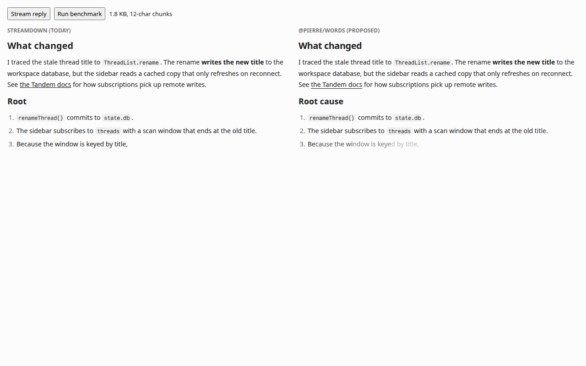

# Benchmarks

The [cover](README.md) gives the verdict. This page shows how Words compares with what Halo uses today, first as a bare parser and then inside Halo's `MessageContent`.

## In the browser, inside MessageContent

The harness renders the Streamdown `MessageContent` from `main` and the Words version from this branch, each wrapped in `MauiProvider` at 640 px wide. It feeds each a growing prefix of a typical agent reply, with headings, lists, a table, a quote, and TypeScript, Bash, and JSON fences, and times each render through layout with `flushSync` and a forced `offsetHeight` read. Headless Chromium, second of two runs per renderer.

| Reply | Chunks | Streamdown total | Words total | Streamdown p95 | Words p95 |
| --- | --- | --- | --- | --- | --- |
| 2.3 KB, 24-character chunks | 79 | 224 ms | 58 ms | 5.9 ms | 1.2 ms |
| 9 KB, 24-character chunks | 316 | 912 ms | 275 ms | 5.2 ms | 1.1 ms |
| 37 KB, 48-character chunks | 631 | 3,548 ms | 736 ms | 10.9 ms | 1.9 ms |

The final, non-streaming render of the 37 KB reply took 145 ms with Streamdown and 30 ms with Words.

A thread holds many messages, so I also mounted 1 to 30 static copies of the 2.3 KB reply in one tree. Each step re-renders every message already on screen:

| | Streamdown | Words |
| --- | --- | --- |
| First mount on a fresh page | 85 ms | 73 ms |
| Later fresh mounts | 14–19 ms | 6.5–8 ms |
| Re-render with 30 messages | 92–100 ms | 4–5 ms |

Both pay a one-time warm-up on first mount. For Words it is compiling its WebAssembly and starting the highlighter; it showed up once as a 66 ms frame in the streaming runs.

## Keeping up with the stream

With both renderers given the same text at the same moment, Streamdown's view trailed the stream: it still showed "Root" while Words showed "Root cause" and was fading in the newest words.

## In Node, as a parser

Whole-document HTML for all of Halo's `.diffmap/` specs (786 KB), and the whole-stream cost of re-rendering `.diffmap/streamed-responses.md` (9 KB) in 40-character chunks:

| | Whole document | Whole stream |
| --- | --- | --- |
| Words, `createHtmlSession` (incremental) | | 1.2 ms |
| Words, `renderToHtml` | 3.8 ms | 7.1 ms |
| `marked.parse` | 22 ms | 40 ms |
| Streamdown through `react-dom/server` | 751 ms | 2,288 ms |

The Streamdown numbers here are an upper bound: server rendering skips the block memoization it does in the browser. The browser numbers above are the ones that matter for Halo.

## Bundle

`vite build` of `apps/web-app`, before and after the swap:

| | `main` | This branch |
| --- | --- | --- |
| Asset files | 710 | 405 |
| All JavaScript | 29.1 MB | 19.1 MB |
| `index` chunk, gzip | 551 KB | 556 KB |
| `SignedInApp` chunk, gzip | 1,301 KB | 1,342 KB |

Most of the drop is lazy Shiki language and theme chunks that `@streamdown/code` emitted. The eager chunks grow 46 KB gzipped because Words and `@pierre/highlights` inline their WebAssembly as base64, which compresses poorly.
