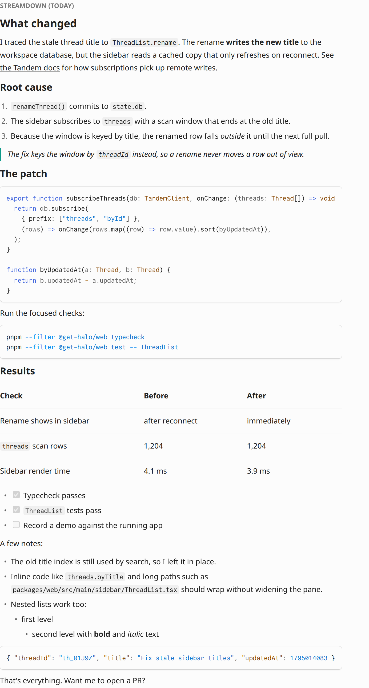
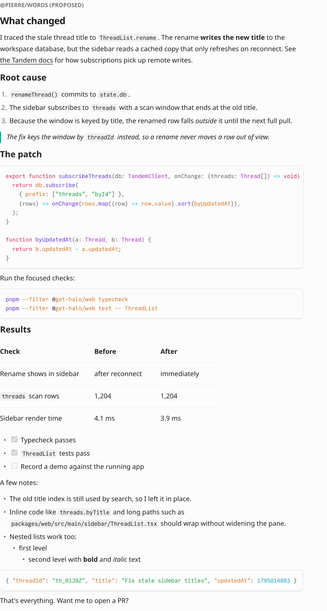
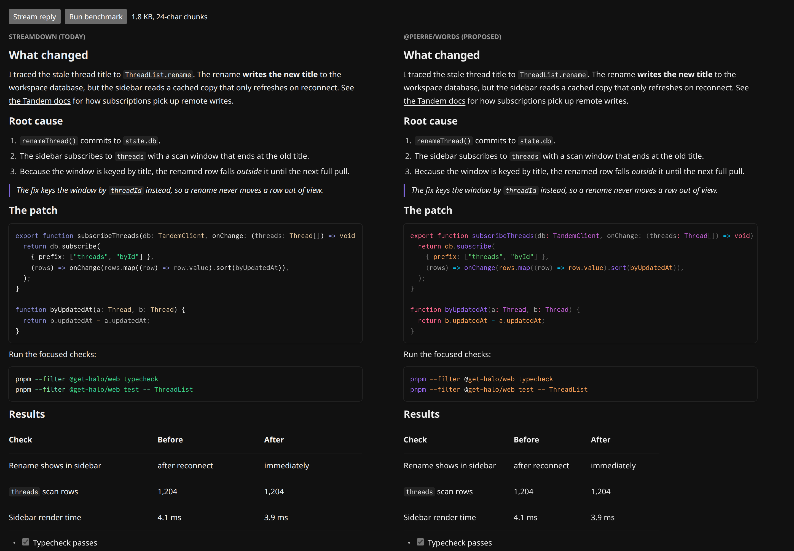

# ✅ Render chat messages with Words

[Benchmarks](01-benchmarks.md) showed Words is faster inside Halo's component. This page is the code change that makes it the renderer.

**Today**

`MessageContent` renders user bubbles and assistant replies with `<Streamdown>`. Streamdown's elements carry Tailwind classes Halo does not load, so the component overrides every element, wraps tables, and swaps fenced code for Maui's `CodeBlock` once the fence closes.

**Proposed**

`MessageContent` renders with Words' `<Markdown>` and keeps the same props, so `AgentPane` does not change. Words emits plain elements that Maui's `proseHtml` already styles. Code highlights as it streams, with Pierre's light or dark theme to match Maui's resolved theme.

:::gallery side-by-side


:::



```callstack [Rendering one assistant reply]
 AgentPane renders a text part [[packages/web/src/main/agent/AgentPane.tsx#L1225-L1232]]
 └── MessageContent({ mode: "streaming", isAnimating, children }) [[8d2c5687:packages/web/src/main/agent/MessageContent.tsx#L37-L68]]
-    └── <Streamdown components={streamdownComponents} plugins={{ code }}>
-        ├── parse the whole string with remark into a React tree
-        ├── map each element through a Maui override
-        └── MauiFencedCode: plain text while open, then <CodeBlock> highlights asynchronously
+    └── <Markdown plugins={highlightPlugins[resolvedTheme]}> [[8d2c5687:packages/web/src/main/agent/MessageContent.tsx#L54-L65]]
+        ├── Words' WebAssembly parser reuses finished blocks
+        ├── createDomRenderer patches only the changed DOM
+        └── createHighlightsPlugin highlights each code line as it arrives [[8d2c5687:packages/web/src/main/agent/MessageContent.tsx#L31-L34]]
```

Maui still owns the look. Words' stylesheet stays for the streaming caret and fade-in, but its layout rules use `[data-markdown]` attribute selectors that outrank Maui's `.class p` rules. `MessageContent` scopes its overrides under the root's own attribute so they win:

```ts
const root = "&[data-markdown='root']";

const markdownRootClass = style({
  [`${root} :is(p, ul, ol, blockquote, table, h1, h2, h3, h4, h5, h6, [data-markdown='code-block'])`]:
    { margin: 0 },
  [`${root} [data-markdown='code-block']`]: {
    ...monoFontStyle,
    boxShadow: shadowVars.subtle,
    backgroundColor: backgroundColor.app,
  },
  [`${root} [data-markdown='code-header']`]: { display: "none" },
  // ...
});
// [!note L4-L5] Maui's `proseHtml` spaces blocks with a flex gap; Words' margins would add to it.
// [!note L6-L10] The same frame as Maui's `CodeBlock`.
```

I styled with CSS instead of Words' `components` hooks for two reasons: hooks return HTML strings, so Maui's React components cannot be used there, and any hook turns off Words' fast path for an open code fence.

## Verification

- `pnpm --filter @get-halo/web typecheck`, `lint`, `format:check`, and its 11 unit tests pass.
- The browser harness rendered both versions in light and dark themes, static and streaming, without console errors.
- Not done: streaming a reply in the running Electron app. This machine has no Google Cloud credentials for the model. Do it before merging.

## Before merging

- Stream a long reply with tables and several code fences in the Electron app.
- Decide whether Pierre's code colors in chat are acceptable, or ask Maui to export its theme in `@pierre/highlights` form.
- Bump `@pierre/diffs` once it accepts `@pierre/highlights` 0.5, so only one highlighter ships.

```changes
8d2c5687
packages/web/src/main/agent/MessageContent.tsx
packages/web/package.json

ignore:
pnpm-lock.yaml
pnpm-workspace.yaml
```
