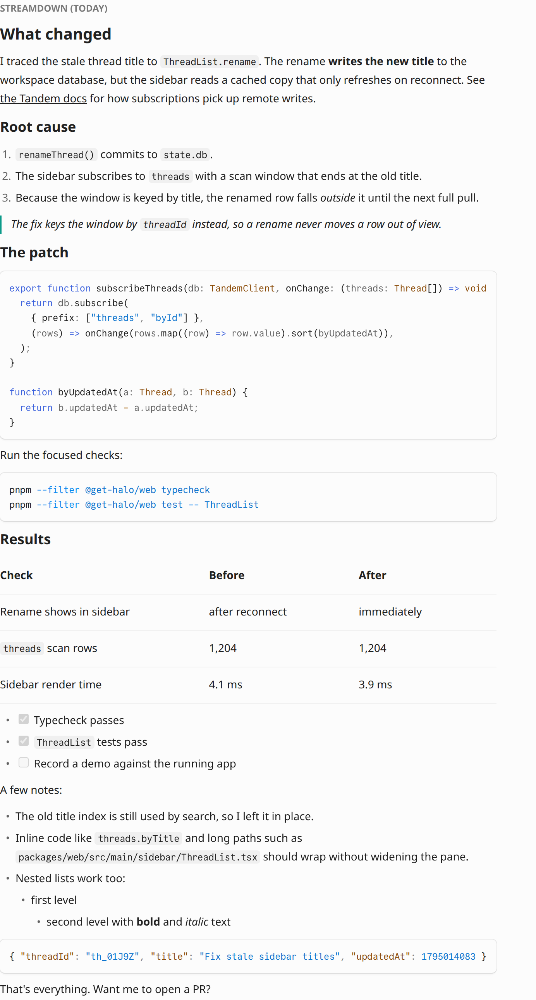
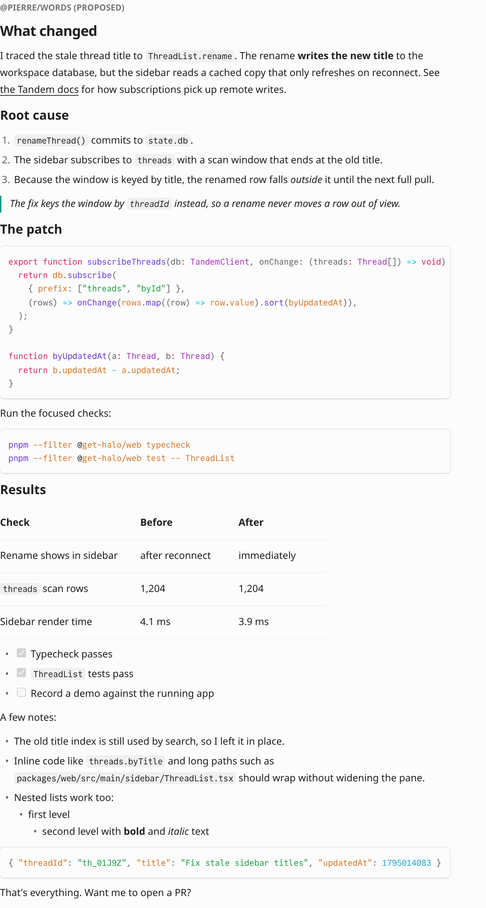

# Trying @pierre/words for Halo chat messages

[Je Xia's post](https://x.com/jexia_/status/2123069061311627332) introduces **Words** (`@pierre/words`), a Markdown renderer from Pierre written in WebAssembly Text. It is built for streamed agent output, claims to be 20x faster than Streamdown, and ships a React `<Markdown>` component with almost the same props as Streamdown's. Halo renders every chat message with Streamdown in `[[packages/web/src/main/agent/MessageContent.tsx]]`, so the question is whether Words should replace it.

**Take: yes, adopt it for chat messages, with an exact version pin.** On Halo's own component and content, Words streams a reply 3 to 4.5 times faster than Streamdown, keeps up with the stream instead of trailing it, re-renders a 30-message thread in about 4 ms instead of 60 to 100 ms, and looks nearly the same under Maui. The swap touches one file and drops two dependencies. The risk is youth: version 0.2.2, first published a week ago.

:::gallery side-by-side

:::

## What I did

1. Read the package, its types, and its stylesheet: CommonMark and GitHub-flavored Markdown, HTML, DOM, and ANSI output, optional `@pierre/highlights` syntax highlighting, Mermaid, math, and a React component that patches the DOM itself.
2. Benchmarked it against `marked` and Streamdown on Halo's 786 KB of `.diffmap/` specs in Node.
3. Rewrote `MessageContent` on Words with the same props, so `AgentPane` did not change, and removed `streamdown` and `@streamdown/code`.
4. Rendered the old and new `MessageContent` side by side in a browser harness with Maui, streamed a typical agent reply into both, and timed each chunk, full mounts, and thread re-renders.
5. Built the web app before and after to compare bundle output.
6. Ran Halo's Electron end-to-end tests for Markdown, which stream a reply from a scripted model into the packaged app. Both pass.

I could not chat with a real model: this machine has no Google Cloud credentials. Someone should stream a reply with code fences in the app before merging.

## Results at a glance

| | Streamdown | Words |
| --- | --- | --- |
| Stream a 9 KB reply in 24-character chunks (browser) | 912 ms | 275 ms |
| p95 cost per chunk | 5.2 ms | 1.1 ms |
| Re-render a 30-message thread | 60–100 ms | about 4 ms |
| Mount one more message (warm) | about 15 ms | about 6.5 ms |
| Web app build output | 710 asset files | 405 asset files |
| Eager app chunks, gzip | 1,852 KB | 1,898 KB (+46 KB) |

[Benchmarks](01-benchmarks.md) has the method and raw numbers; [the swap](02-message-content-swap.md) walks through the code change.

## What works

- **Speed where Halo feels it.** When a thread re-renders, Streamdown does real work for every message; Words leaves unchanged messages alone and, while streaming, reuses finished blocks and patches only the open one.
- **Nearly identical output.** Words emits plain `h2`, `p`, `ul`, and `table` elements, so Maui's `proseHtml` styles them without Streamdown's per-element overrides.
- **One highlighter story.** Code blocks use Pierre's `pierre-light` and `pierre-dark` themes, the same ones Halo's code viewer uses through `@pierre/diffs`.
- **Smaller build.** `@streamdown/code` emitted every Shiki language and theme as a lazy chunk; those 300 files go away.

## What doesn't, or costs something

- **Young package.** Six releases since November 11. Halo's minimum-release-age policy blocks it, so the change adds a `minimumReleaseAgeExclude` entry for `@pierre/words@0.2.2`.
- **Styling through attributes.** Words' stylesheet uses `[data-markdown]` selectors that outrank Maui's prose rules, so `MessageContent` overrides them with higher-specificity selectors. Those attribute names are output, not a documented contract.
- **Hooks are string transforms.** `components` hooks take and return HTML, so Maui's React `CodeBlock` and `Code` cannot plug in; any hook also turns off Words' fast path for an open code fence. The swap styles elements with CSS instead.
- **Different code colors.** Chat code now uses Pierre's theme, not Maui's Shiki theme. That matches the code viewer but differs from other Maui `CodeBlock`s.
- **Two highlighter versions.** `@pierre/diffs` pins `@pierre/highlights` 0.2.0; Words needs 0.5.1 or later. Both ship until `@pierre/diffs` updates.
- **Eager bundle grows 46 KB gzipped.** Words and the highlighter inline their WebAssembly as base64.
- **Tables no longer stretch to full width.** Words makes the table element scroll itself, so a narrow table sizes to its content.

## Goals and non-goals

- Goal: decide whether Words should render Halo chat messages, using Halo's component and content.
- Non-goal: replace `marked` in the editor's Markdown syntax highlighting or in workspace search, which need tokens, not HTML.
- Non-goal: Mermaid and math in chat. Words supports both; Halo can turn them on later.

## References

- `[[packages/web/src/main/agent/MessageContent.tsx]]`, the only Streamdown consumer
- `[[packages/web/src/main/agent/AgentPane.tsx#L1225-L1232]]`, where assistant replies stream into it
- [@pierre/words on npm](https://www.npmjs.com/package/@pierre/words), [demo](https://diffs.com/words), [docs](https://diffs.com/docs#words)
