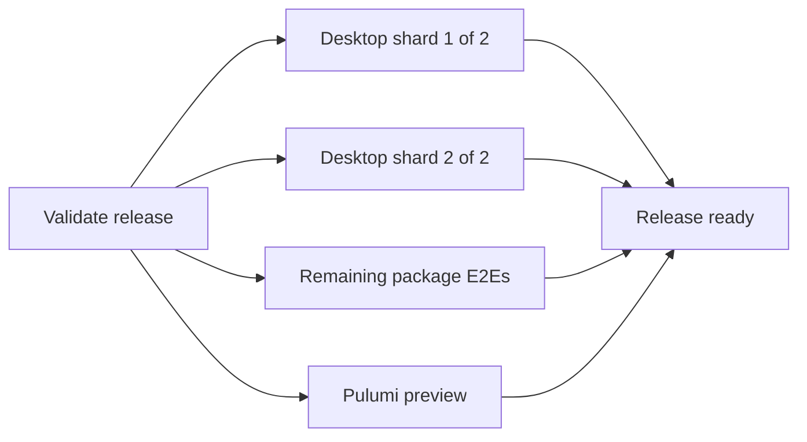

# Faster staging releases

Staging 0.1.96 took 10m43s to validate its release PR and 20m08s to deploy after merge. The release keeps every test, protocol check, signing check, and rollout readiness check. This change reduces serial test work and image cache invalidation.

## ✅ Release tests and image layers

**Today:** The release E2E command runs every package in sequence. Desktop tests take about six minutes, followed by the other package tests. Workspace Chrome refreshes invalidate dependency installation and compilation; a recursive ownership change copies package files into another image layer. Control-plane source changes invalidate dependency installation.

**Proposed:** Two isolated macOS jobs run Playwright desktop shards; a third runs all remaining package E2Es with Turbo cache reuse disabled. `Release ready` requires both desktop shards and the package job. Desktop units and packaging run in each shard. The full local `test:e2e:release` command stays available.

```changes
2dd943ae..6a377ce3
.github/workflows/release.yml
apps/workspace-server/Dockerfile
apps/control-plane/Dockerfile
AGENTS.md
```

The workspace image compiles in a branch before Chrome installation, then copies built packages with their runtime ownership. Weekly Chrome updates keep the same policy while reusing dependency and compilation layers. Control-plane dependencies install from package manifests before source files enter the image.

Expected savings are about two minutes from separating package tests, another two to three from desktop sharding, and one to three after merge from both image changes. These are estimates; compare the next release with the baseline before claiming an improvement. Sharding uses more macOS runner time.



## Verification

Local validation passed:

- Workflow lint and formatting; all 512 combinations of release gate results; shard listing covers 34 + 33 = 67 unique desktop tests; the remaining-package filter excludes only desktop.
- Release validation: 18 tests. Affected checks: 22 tasks. Desktop units: 10 tests. Both desktop shards passed with three workers, matching the CI runner's CPU concurrency.
- Remaining package E2Es: 5 tasks with no cache reuse, including 86 workspace tests, 108 control-plane tests, 4 extension-tools tests, and 4 browser tests. Two existing control-plane tests remain skipped.
- Both Linux images built. Runtime smoke checks started the workspace desktop and server, rebuilt and packed the extension SDK/tools as the node user, checked immutable reference source, and served control-plane health and browser assets.
- A Chrome refresh reused workspace dependency installation and compilation. A control-plane source edit reused dependency installation.

An initial seven-worker desktop run failed two UI tests. Both passed individually, and both complete shards then passed at three workers. No application or test assertions changed.

Entire CLI is unavailable; checkpoint and local Trail inspection could not run. The next release PR must measure matrix scheduling and elapsed savings on CI. This PR adds no release manifest and does not deploy.

Image validation used isolated tags and caches. [Runtime smoke check](https://console.cloud.google.com/cloud-build/builds;region=us-west2/c70a6870-c1e1-4f1c-99ed-a134e572a2e1?project=halo-relay), [Chrome cache probe](https://console.cloud.google.com/cloud-build/builds;region=us-west2/fa3be058-65a1-4e33-a9b1-183c5ee0612d?project=halo-relay), [source cache probe](https://console.cloud.google.com/cloud-build/builds;region=us-west2/b3cb9692-5ca9-4682-92db-30262410ecda?project=halo-relay).

## References

- [[6a377ce3:.github/workflows/release.yml]]
- [[6a377ce3:apps/workspace-server/Dockerfile]]
- [[6a377ce3:apps/control-plane/Dockerfile]]
- [0.1.96 release PR checks](https://github.com/cashew-labs/halo/actions/runs/41497381500)
- [0.1.96 deployment](https://github.com/cashew-labs/halo/actions/runs/41499256425)
