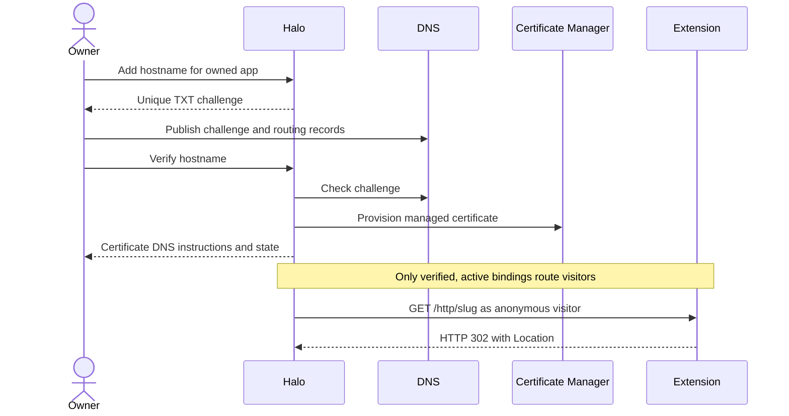

# Custom domains for hosted extensions

Hosted extensions can own branded links without moving their data into Halo's
control-plane database. Halo verifies hostname ownership, terminates HTTPS, and
routes public GET/HEAD requests to the extension's HTTP entry. The extension
returns its own response, including redirects to any absolute HTTP(S) URL.

## Requirements

- DNS verification binds one hostname to one published extension.
- Agent APIs and CLI manage domains; no management UI.
- Public requests have no owner credentials or private storage sync access.
- Halo's main application and creator-host sign-in remain separate origins.

## ✅ Phase 1: Extension HTTP responses

**Today:** [[packages/extension-sdk/src/server.ts]] serves only API, sync, and view routes.
**Proposed:** Optional `http.ts` supplies a standard Request/Response handler at
`/http/`; the build includes it only on the server. GET/HEAD handlers receive
read-only storage queries and no caller identity or Halo tools. Internal proxy
authentication remains required, and response cookies are stripped.

## ✅ Phase 2: Verified bindings and routing

**Today:** [[apps/control-plane/src/apps/AppGateway.ts]] routes creator app paths.
**Proposed:** Owner APIs create a unique TXT challenge for an app/hostname.
Verification and activation are separate from registration. Unknown hosts never
fall back to Halo's authenticated application. Active custom hosts route only to
an explicitly published public app's HTTP surface, with anonymous identity.

## ✅ Phase 3: Managed HTTPS

**Today:** [[infra/control-plane/index.ts]] provisions certificates for Halo and creator hosts.
**Proposed:** A host-supplied certificate provider provisions custom-host DNS
authorization, managed certificates and certificate-map entries. Owners receive
all required DNS records and poll verification until HTTPS becomes active.

## Non-goals

This platform change does not deploy the marketing extension, edit DNS, or move
its links into Halo's database. HTTP handlers do not expose the management API on
custom hosts. The existing creator-host address remains the management surface.

## References

- [[packages/extension-tools/src/build.ts]]
- [[apps/control-plane/src/apps/AppStore.ts]]
- https://docs.cloud.google.com/certificate-manager/docs/dns-authorizations
