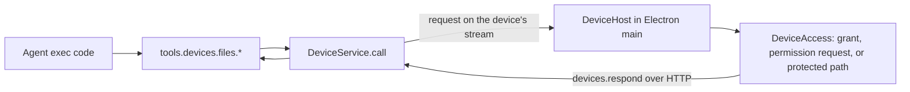

# Local devices

The workspace agent can use the person's own computers. Every computer running the Halo desktop app connects to its workspace as a **device** automatically. Nothing is shared until the person allows it on a permission card in the chat.

Status: file access and local commands are implemented. Local computer use is planned.

## System flow

## How a device connects

- Electron main starts `LocalDevice`, which reads `device.json` from app data and starts a `DeviceHost` (`apps/electron/src/main/device/LocalDevice.ts`).
- On a new install the device is enabled with no grants. While enabled, `DeviceHost` opens its own workspace socket with a fresh client ID and calls `devices.serve` with its advertisement: ID, name, platform, and home folder (`packages/device-host/src/DeviceHost.ts`).
- The device uses the same workspace connection as the renderer: the local renderer token in development, or the Better Auth bearer token through the control-plane gateway in production. The gateway needs no device-specific route.
- `devices.serve` is an event stream of `DeviceRequest`s. The device answers each with `devices.respond`, which always uses HTTP because file bodies can be large (`packages/client/src/createHaloClient.ts`).
- The workspace CLI cannot serve a device; `devicesRouter` refuses CLI connections (`packages/workspace-server/src/devices/devicesRouter.ts`).
- The device reconnects with backoff after a lost connection, including the server's 55-minute socket limit. Turning the device off or renaming it reconnects; grant changes apply without reconnecting.

## Routing and failures

- `DeviceService` keeps devices by ID and resolves a name or ID per call (`packages/workspace-server/src/devices/DeviceService.ts`).
- An offline device fails at once with `DeviceOfflineError`.
- A disconnect keeps pending calls for 20 seconds so a reconnecting device can still answer. After that they fail with `DeviceDisconnectedError`; the result is unknown and nothing is replayed.
- Calls time out after 60 seconds with `DeviceTimeoutError`; commands get their own timeout plus 30 seconds.
- Device errors reach the agent with their code, for example `access_denied` or `read_only`.

## Agent tools

Exec-only tools under `tools.devices` (`packages/workspace-server/src/devices/deviceTools.ts`):

| Tool                                    | Capability                                    |
| --------------------------------------- | --------------------------------------------- |
| `devices.list`                          | `devices.list`                                |
| `devices.files.list`, `read`            | `devices.files.read`                          |
| `devices.files.write`, `edit`, `delete` | `devices.files.write`                         |
| `devices.files.copyToWorkspace`         | `devices.files.read`, `workspace.files.write` |
| `devices.files.copyFromWorkspace`       | `workspace.files.read`, `devices.files.write` |
| `devices.shell.run`                     | `devices.shell.execute`                       |

Every call names its device. Paths may be absolute, `~/`, or relative to the device's home folder. Text reads and edits reuse the workspace file helpers through the `TextFiles` interface. Transfers are limited to 8 MiB.

Shared apps get no device tools, and extensions cannot call them (`extensionToolPolicy.ts`).

## Local commands

`tools.devices.shell.run({ device, command, cwd?, timeoutMs? })` runs a command in the person's login shell (`$SHELL -lc`) on the device, starting in the home folder unless `cwd` is given (`packages/device-host/src/DeviceShell.ts`).

- Until the person allows commands, the device returns `permission_required` and the agent's chat shows a card with the command: Allow commands or Don't allow. The card says commands run with the person's full access, because folder grants and protected paths do not limit a shell.
- Allowing is saved as `commands.allowed` in `device.json`.
- Each command gets its own process group. A timeout (default 60 seconds, maximum 10 minutes) or a cancellation sends SIGTERM to the group, then SIGKILL after one second.
- When the agent cancels a call or the workspace stops waiting, `DeviceService` sends `{ cancel: callId }` on the device stream and the device stops that call.
- Output keeps the first 8,000 and last 24,000 characters of each stream. The result is `code`, `signal`, `timedOut`, `stdout`, `stderr`, and `truncated`.

## What the device allows

The device decides; the workspace cannot widen its answers (`packages/device-host/src/DeviceAccess.ts`):

- **Enabled:** always on while the app runs. There is no settings UI.
- **Grants:** an operation in a folder without a sufficient grant returns `permission_required` with the folder, access, and path. A file request asks about its parent folder; a listing asks about the folder itself. Grants cover subfolders and are saved in `device.json`.
- **Real paths:** requests and grants resolve through symlinks, so a link inside an allowed folder that points elsewhere asks about its real location.
- **Protected paths:** credential folders under home, such as `~/.ssh`, `~/.aws`, and `~/Library/Keychains`, are refused and never offered.

## Permission cards

A permission request becomes an approval card in the thread, using the existing approval flow:

- The device tool calls `ToolRuntime.requestApproval` with `{ devicePermission }` arguments. The exec result becomes `ToolInputRequiredError`, and the card is stored with the tool result (`packages/workspace-server/src/devices/deviceTools.ts`).
- `DevicePermissionCard` renders it in place of the generic approval card (`packages/web/src/main/agent/DevicePermissionCard.tsx`). It offers Allow read only (read requests), Allow read and write, or Allow commands, plus Don't allow.
- Only Halo on that computer can allow: the click records the grant on the device through Electron IPC (`allowDevicePermission` → `LocalDevice.allow`), then answers the approval. Elsewhere the card says to open Halo on that computer; Don't allow works anywhere.
- Answering sends the agent the usual approval continuation: retry after Allow, do not retry after Don't allow.

## Tests

- `packages/device-host/src/DeviceFiles.test.ts`: permission requests for new folders and changes, remembered grants, symlinks, protected paths, and file limits.
- `packages/workspace-server/src/devices/DeviceService.test.ts`: delivery, reconnect grace, timeout, and responder checks.
- `packages/workspace-server/test/devices.spec.ts`: a real `DeviceHost` against a real workspace server.
- `packages/device-host/src/DeviceShell.test.ts`: the commands permission, working folders, timeouts that stop child processes, cancellation, and long output.
- `apps/electron/e2e/device.e2e.test.ts`: a folder card, a commands card, and a refusal, each answered in the chat, with the agent's retry or acknowledgement.

## Next

1. Local computer use: run `ComputerService` on the device with the OpenSky driver.
2. A composer reference for local files (`local://<device>/<path>`).
