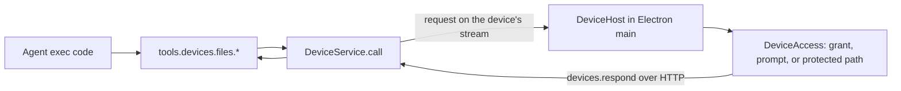
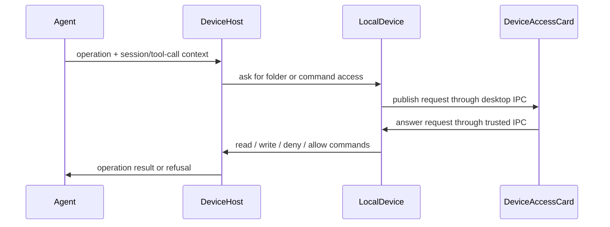

# Local devices

The workspace agent can use the person's own computers. Every computer running the Halo desktop app connects to its workspace as a **device** automatically; nothing is shared until the person answers an access prompt. The agent loop, threads, and state stay on the workspace server; only device tool calls run on the computer.

Status: file access and local commands are implemented. Local computer use is planned.

## System flow



## How a device connects

- Electron main starts `LocalDevice`, which reads `device.json` from app data and starts a `DeviceHost` (`apps/electron/src/main/device/LocalDevice.ts`).
- On a new install the device is enabled with no grants. While enabled, `DeviceHost` opens its own workspace socket with a fresh client ID and calls `devices.serve` with its advertisement: ID, name, platform, and home folder (`packages/device-host/src/DeviceHost.ts`).
- The device uses the same workspace connection as the renderer: the local renderer token in development, or the Better Auth bearer token through the control-plane gateway in production. The gateway needs no device-specific route.
- `devices.serve` is an event stream of `DeviceRequest`s. The device answers each with `devices.respond`, which always uses HTTP because file bodies can be large (`packages/client/src/createHaloClient.ts`).
- The workspace CLI cannot serve a device; `devicesRouter` refuses CLI connections (`packages/workspace-server/src/devices/devicesRouter.ts`).
- The device reconnects with backoff after a lost connection, including the server's 55-minute socket limit. Turning the device off or renaming it reconnects; grant changes apply without reconnecting.

## Routing and failures

- `DeviceService` keeps devices by ID and resolves a name or ID per call (`packages/workspace-server/src/devices/DeviceService.ts`).
- An offline device fails at once with `DeviceOfflineError`.
- A disconnect keeps pending calls for 20 seconds so a reconnecting device can still answer. After that they fail with `DeviceDisconnectedError`; the result is unknown and nothing is replayed.
- Calls time out after 5 minutes with `DeviceTimeoutError`, leaving time to answer an access prompt.
- Device errors reach the agent with their code, for example `access_denied` or `read_only`.

## Agent tools

Exec-only tools under `tools.devices` (`packages/workspace-server/src/devices/deviceTools.ts`):

| Tool                                    | Capability                                    |
| --------------------------------------- | --------------------------------------------- |
| `devices.list`                          | `devices.list`                                |
| `devices.files.list`, `read`            | `devices.files.read`                          |
| `devices.files.write`, `edit`, `delete` | `devices.files.write`                         |
| `devices.files.copyToWorkspace`         | `devices.files.read`, `workspace.files.write` |
| `devices.files.copyFromWorkspace`       | `workspace.files.read`, `devices.files.write` |
| `devices.shell.run`                     | `devices.shell.execute`                       |

Every call names its device. Paths may be absolute, `~/`, or relative to the device's home folder. Text reads and edits reuse the workspace file helpers through the `TextFiles` interface. Transfers are limited to 8 MiB.

Shared apps get no device tools, and extensions cannot call them (`extensionToolPolicy.ts`).

## Local commands

`tools.devices.shell.run({ device, command, cwd?, timeoutMs? })` runs a command in the person's login shell (`$SHELL -lc`) on the device, starting in the home folder unless `cwd` is given (`packages/device-host/src/DeviceShell.ts`).

- The first command asks once in the requesting chat: Allow commands or Don't allow. Neither choice receives keyboard focus automatically. The card shows the command and says commands run with the person's full access, because folder grants and protected paths do not limit a shell.
- The answer is saved as `commands.allowed` in `device.json` and shown on the answered card with Remove access. A refusal lasts until the app restarts or the person changes permissions.
- Each command gets its own process group. A timeout (default 60 seconds, maximum 10 minutes) or a cancellation sends SIGTERM to the group, then SIGKILL after one second.
- When the agent cancels a call or the workspace stops waiting, `DeviceService` sends `{ cancel: callId }` on the device stream and the device stops that call.
- Output keeps the first 8,000 and last 24,000 characters of each stream. The result is `code`, `signal`, `timedOut`, `stdout`, `stderr`, and `truncated`.

## What the device allows

The device decides; the workspace cannot widen its answers (`packages/device-host/src/DeviceAccess.ts`):

- **Enabled:** on by default. The desktop connects automatically. Account settings does not show device controls.
- **Grants:** the first time the agent uses a folder without a grant, Electron publishes a permission card beside the requesting tool activity in chat: Allow read and write, Allow read only, or Don't allow (`apps/electron/src/main/device/LocalDevice.ts`, `packages/web/src/main/agent/DeviceAccessCard.tsx`). A file request asks about its parent folder; a listing asks about the folder itself. Grants cover subfolders and are saved in `device.json`.
- **Refusals:** remembered until the app restarts or the grants change, so the agent cannot prompt repeatedly. Concurrent requests for one folder share a prompt. An unanswered prompt closes after 4 minutes and refuses.
- **Real paths:** requests and grants resolve through symlinks, so a link inside an allowed folder that points elsewhere asks about its real location.
- **Protected paths:** credential folders under home, such as `~/.ssh`, `~/.aws`, and `~/Library/Keychains`, are refused without a prompt.

Account settings contains no **This computer** section. Answered permission cards show the granted access and **Remove access**. The desktop owns the request and accepts the answer through trusted desktop IPC; a browser or another computer cannot approve it. Cards remain with their tool activity for the lifetime of the desktop process. Saved grants persist across restarts.

## Chat permission UI

The workspace includes the session ID and parent tool-call ID in each device request. `DeviceAccess` still resolves real paths, blocks credential folders, and checks saved permissions on the device. When a decision is needed, `LocalDevice` publishes an in-memory request to its own renderer. The renderer places a Maui card beside that call in the session transcript, using the same surface as connection cards. Native sheets, window flashing, and Dock bouncing are removed.



### Goals

- Put permission choices beside the action that needs them.
- Keep permission decisions and file enforcement on the owning computer.
- Show the folder, or command and full-access warning, before the person answers.
- Let the person remove saved access from the answered card.

### Non-goals

- A new device-management screen or browser-based approval.
- Changing file access limits, protected paths, or shell execution policy.

### ⏳ Phase 1: Replace account controls and native sheets

**Today**

Device settings appeared in Account. Permission requests opened modal macOS sheets.

**Proposed**

Remove the Account section and display desktop-owned permission cards in the requesting chat. Carry the session/tool-call context with device requests so cards remain next to the right action. Stop should close a pending card without remembering a refusal. An unanswered request should expire as a refusal so the agent cannot immediately ask again.

```callstack
 deviceTools → DeviceService.call → DeviceHost.handle
+├── DeviceAccess.authorize / authorizeCommand # enforce saved permissions locally
-│   └── LocalDevice.ask / askCommands → dialog.showMessageBox [[device-chat:old:105-109]]
+│   └── LocalDevice.requestAccess [[apps/electron/src/main/device/LocalDevice.ts#LocalDevice.requestAccess]] → desktop IPC → DeviceAccessCard [[packages/web/src/main/agent/DeviceAccessCard.tsx#DeviceAccessCard]]
+│       └── respondToAccessRequest # resolve only a pending matching request
 └── DeviceFiles / DeviceShell # perform the allowed operation
```

Validation: `pnpm run check-affected` passed. The three macOS device Electron E2Es passed: file access, command approval/removal/refusal, and cancelling a pending folder card before deciding later. The running app's Account dialog and pending file card were inspected at desktop and narrow viewport sizes. The original interactive A–L checklist stopped on a live timeout regression; the Account section and native-sheet expectations are superseded by this change.

**Known issue, not fixed:** Leaving the read card unanswered caused it to become Cancelled, then the agent issued a second read and another card for the same folder. `DeviceAccess.answer` and `answerCommands` return early whenever the combined signal aborts, so they treat the four-minute timeout like an explicit Stop and skip remembered refusal state. Timeout must be distinguished from cancellation before this layer is ready. The grocery fixture stayed unchanged; no file or command access was granted. The dev stack and fixture were cleaned up.

## Tests

- `packages/device-host/src/DeviceFiles.test.ts`: prompting once per folder, shared prompts, remembered refusals, read-only answers, symlinks, protected paths, and failed prompts.
- `packages/workspace-server/src/devices/DeviceService.test.ts`: delivery, reconnect grace, timeout, and responder checks.
- `packages/workspace-server/test/devices.spec.ts`: a real `DeviceHost` against a real workspace server.
- `packages/device-host/src/DeviceShell.test.ts`: prompting once, refusals, working folders, timeouts that stop child processes, cancellation, and long output.
- `apps/electron/e2e/device.e2e.test.ts`: Account omits device controls; a file read waits for its chat card, then reads successfully. Command access is granted, removed, requested again, and refused through chat cards.

## Next

1. Local computer use: run `ComputerService` on the device with the OpenSky driver.
2. A composer reference for local files (`local://<device>/<path>`).

## References

- [[apps/electron/src/main/device/LocalDevice.ts]]
- [[packages/web/src/main/agent/DeviceAccessCard.tsx]]
- [[packages/web/src/main/agent/ExecutorConnectionCard.tsx]]
- [[apps/electron/e2e/device.e2e.test.ts]]

```source-diff:device-chat:apps/electron/src/main/device/LocalDevice.ts
diff --git a/apps/electron/src/main/device/LocalDevice.ts b/apps/electron/src/main/device/LocalDevice.ts
index 26cfb1b4..33d0615c 100644
--- a/apps/electron/src/main/device/LocalDevice.ts
+++ b/apps/electron/src/main/device/LocalDevice.ts
@@ -1,3 +1,3 @@
-import os from "node:os";
-import path from "node:path";
-import { app, dialog, type BrowserWindow } from "electron";
+import crypto from "node:crypto";
+import * as errore from "errore";
+import type { BrowserWindow } from "electron";
@@ -16 +16,6 @@ import type { Logger } from "@get-halo/logger";
-import type { LocalDeviceState } from "@get-halo/web/HostApi";
+import type {
+  LocalDeviceState,
+  LocalDeviceAccessRequest,
+  LocalDeviceAccessAnswer,
+} from "@get-halo/web/HostApi";
+import { DEVICE_ACCESS_CHANNEL } from "../../shared/desktop.js";
@@ -19 +24,5 @@ import type { HaloRpcConnection } from "../../shared/HaloRpcConnection.js";
-const answers: readonly DeviceAccessAnswer[] = ["write", "read", "deny"];
+class DeviceAccessResponseError extends errore.createTaggedError({
+  name: "DeviceAccessResponseError",
+  message:
+    "This permission request is no longer available or the answer does not match it.",
+}) {}
@@ -25,0 +35,6 @@ export class LocalDevice {
+  // Requests stay beside their tool activity for the lifetime of this desktop.
+  private readonly requests = new Map<string, LocalDeviceAccessRequest>();
+  private readonly answers = new Map<
+    string,
+    (answer: LocalDeviceAccessAnswer) => void
+  >();
@@ -91,0 +107,10 @@ export class LocalDevice {
+    for (const request of this.requests.values()) {
+      if (!["read", "write", "allowed"].includes(request.status)) continue;
+      const prompt = request.prompt;
+      const allowed =
+        prompt.kind === "commands"
+          ? saved.commands?.allowed === true
+          : saved.files.grants.some((grant) => grant.path === prompt.folder);
+      if (!allowed) request.status = "removed";
+    }
+    this.publishRequests();
@@ -100,0 +126 @@ export class LocalDevice {
+    for (const answer of this.answers.values()) answer("deny");
@@ -103,0 +130,33 @@ export class LocalDevice {
+  accessRequests() {
+    return [...this.requests.values()];
+  }
+
+  respondToAccessRequest(input: {
+    requestId: string;
+    answer: LocalDeviceAccessAnswer;
+  }) {
+    const request = this.requests.get(input.requestId);
+    const answer = this.answers.get(input.requestId);
+    if (
+      request === undefined ||
+      answer === undefined ||
+      request.status !== "pending"
+    )
+      return new DeviceAccessResponseError();
+    if (
+      input.answer !== "deny" &&
+      (request.prompt.kind === "commands"
+        ? input.answer !== "allowCommands"
+        : input.answer === "allowCommands")
+    )
+      return new DeviceAccessResponseError();
+    answer(input.answer);
+  }
+
+  private publishRequests() {
+    this.getWindow()?.webContents.send(
+      DEVICE_ACCESS_CHANNEL,
+      this.accessRequests(),
+    );
+  }
+
@@ -105,13 +164,2 @@ export class LocalDevice {
-    const window = this.getWindow();
-    // Draw attention without taking focus from whatever the person is doing.
-    window?.flashFrame(true);
-    app.dock?.bounce("informational");
-    const verb = request.access === "write" ? "change" : "read";
-    const options: Electron.MessageBoxOptions = {
-      type: "question",
-      message: `Allow Halo to ${verb} files in ${displayPath(request.folder)}?`,
-      detail: `The Halo agent asked to ${verb} ${displayPath(request.path)}. Your answer applies to this folder and its subfolders. You can remove it later in Account settings.`,
-      buttons: ["Allow read and write", "Allow read only", "Don't allow"],
-      defaultId: request.access === "write" ? 0 : 1,
-      cancelId: 2,
-      noLink: true,
+    const answer = await this.requestAccess({
+      context: request.context,
@@ -119,8 +167,8 @@ export class LocalDevice {
-    };
-    const chosen =
-      window === undefined
-        ? await dialog.showMessageBox(options)
-        : await dialog.showMessageBox(window, options);
-    window?.flashFrame(false);
-    if (request.signal.aborted) return "deny";
-    return answers[chosen.response] ?? "deny";
+      prompt: {
+        kind: "files",
+        folder: request.folder,
+        path: request.path,
+        access: request.access,
+      },
+    });
+    return answer === "read" || answer === "write" ? answer : "deny";
@@ -129,14 +177,31 @@ export class LocalDevice {
-  private async askCommands(request: DeviceCommandRequest): Promise<boolean> {
-    const window = this.getWindow();
-    window?.flashFrame(true);
-    app.dock?.bounce("informational");
-    const options: Electron.MessageBoxOptions = {
-      type: "warning",
-      message: "Allow Halo to run commands on this computer?",
-      detail: `The Halo agent wants to run this in ${displayPath(request.cwd)}:\n\n${request.command}\n\nCommands run as you, with your full access, including folders you have not allowed. Halo remembers your answer; you can remove it later in Account settings.`,
-      buttons: ["Allow commands", "Don't allow"],
-      // Running commands is broad access, so Return does not allow it.
-      defaultId: 1,
-      cancelId: 1,
-      noLink: true,
-      signal: request.signal,
+  private async askCommands(request: DeviceCommandRequest) {
+    return (
+      (await this.requestAccess({
+        context: request.context,
+        signal: request.signal,
+        prompt: {
+          kind: "commands",
+          command: request.command,
+          cwd: request.cwd,
+        },
+      })) === "allowCommands"
+    );
+  }
+
+  private async requestAccess(input: {
+    context: DeviceAccessRequest["context"];
+    signal: AbortSignal;
+    prompt: LocalDeviceAccessRequest["prompt"];
+  }): Promise<LocalDeviceAccessAnswer> {
+    if (input.signal.aborted) return "deny";
+    const { sessionId, toolCallId } = input.context ?? {};
+    if (sessionId === undefined || toolCallId === undefined) {
+      this.logger.warn({ event: "device-permission-without-chat" });
+      return "deny";
+    }
+    const request: LocalDeviceAccessRequest = {
+      id: crypto.randomUUID(),
+      sessionId,
+      toolCallId,
+      status: "pending",
+      prompt: input.prompt,
@@ -144,6 +209,20 @@ export class LocalDevice {
-    const chosen =
-      window === undefined
-        ? await dialog.showMessageBox(options)
-        : await dialog.showMessageBox(window, options);
-    window?.flashFrame(false);
-    return !request.signal.aborted && chosen.response === 0;
+    this.requests.set(request.id, request);
+    return await new Promise<LocalDeviceAccessAnswer>((resolve) => {
+      const finish = (answer: LocalDeviceAccessAnswer) => {
+        this.answers.delete(request.id);
+        input.signal.removeEventListener("abort", cancel);
+        request.status = input.signal.aborted
+          ? "cancelled"
+          : answer === "deny"
+            ? "denied"
+            : answer === "allowCommands"
+              ? "allowed"
+              : answer;
+        this.publishRequests();
+        resolve(answer);
+      };
+      const cancel = () => finish("deny");
+      this.answers.set(request.id, finish);
+      input.signal.addEventListener("abort", cancel, { once: true });
+      this.publishRequests();
+    });
@@ -162,8 +240,0 @@ export class LocalDevice {
-
-function displayPath(target: string) {
-  const relative = path.relative(os.homedir(), target);
-  if (relative === "") return "your home folder";
-  return relative.startsWith("..") || path.isAbsolute(relative)
-    ? target
-    : `~/${relative}`;
-}
```
