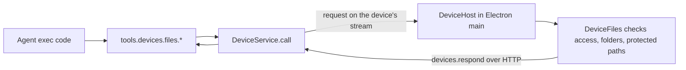

# Local devices

The workspace agent can use the person's own computers. A computer running the Halo desktop app connects to its workspace as a **device** when the person turns it on. The agent loop, threads, and state stay on the workspace server; only device tool calls run on the computer.

Status: the workspace protocol and the agent file tools are implemented. The reusable device host and the desktop settings land in the next two changes. Local bash and local computer use are planned.

## System flow

## How a device connects

- Electron main starts `LocalDevice`, which reads `device.json` from app data and starts a `DeviceHost` (`apps/electron/src/main/device/LocalDevice.ts`).
- When enabled, `DeviceHost` opens its own workspace socket with a fresh client ID and calls `devices.serve` with its advertisement: ID, name, platform, home folder, and file settings (`packages/device-host/src/DeviceHost.ts`).
- The device uses the same workspace connection as the renderer: the local renderer token in development, or the Better Auth bearer token through the control-plane gateway in production. The gateway needs no device-specific route.
- `devices.serve` is an event stream of `DeviceRequest`s. The device answers each with `devices.respond`, which always uses HTTP because file bodies can be large (`packages/client/src/createHaloClient.ts`).
- The workspace CLI cannot serve a device; `devicesRouter` refuses CLI connections (`packages/workspace-server/src/devices/devicesRouter.ts`).
- The device reconnects with backoff after a lost connection, including the server's 55-minute socket limit. Changing settings reconnects with a new advertisement.

## Routing and failures

- `DeviceService` keeps devices by ID and resolves a name or ID per call (`packages/workspace-server/src/devices/DeviceService.ts`).
- An offline device fails at once with `DeviceOfflineError`.
- A disconnect keeps pending calls for 20 seconds so a reconnecting device can still answer. After that they fail with `DeviceDisconnectedError`; the result is unknown and nothing is replayed.
- Calls time out after 60 seconds with `DeviceTimeoutError`.
- Device errors reach the agent with their code, for example `outside_allowed_folders` or `read_only`.

## Agent tools

Exec-only tools under `tools.devices` (`packages/workspace-server/src/devices/deviceTools.ts`):

| Tool                                    | Capability                                    |
| --------------------------------------- | --------------------------------------------- |
| `devices.list`                          | `devices.list`                                |
| `devices.files.list`, `read`            | `devices.files.read`                          |
| `devices.files.write`, `edit`, `delete` | `devices.files.write`                         |
| `devices.files.copyToWorkspace`         | `devices.files.read`, `workspace.files.write` |
| `devices.files.copyFromWorkspace`       | `workspace.files.read`, `devices.files.write` |

Every call names its device. Paths may be absolute, `~/`, or relative to the device's home folder. Text reads and edits reuse the workspace file helpers through the `TextFiles` interface. Transfers are limited to 8 MiB.

Shared apps get no device tools, and extensions cannot call them (`extensionToolPolicy.ts`).

## What the device allows

The device enforces its own settings; the workspace cannot widen them (`packages/device-host/src/DeviceFiles.ts`):

- **Enabled:** off by default on a new install.
- **File access:** off, read only, or read and write.
- **Shared folders:** chosen with the native folder picker. Paths are resolved through symlinks, so a link cannot escape a shared folder.
- **Protected paths:** credential folders under home, such as `~/.ssh`, `~/.aws`, and `~/Library/Keychains`, are never served.

The person changes these in the account dialog's **This computer** section (`packages/web/src/sidebar/DeviceSettings.tsx`). There are no per-action approval prompts.

## Tests

- `packages/device-host/src/DeviceFiles.test.ts`: folder, symlink, protected-path, and access-level rules.
- `packages/workspace-server/src/devices/DeviceService.test.ts`: delivery, reconnect grace, timeout, and responder checks.
- `packages/workspace-server/test/devices.spec.ts`: a real `DeviceHost` against a real workspace server.
- `apps/electron/e2e/device.e2e.test.ts`: turn the computer on in settings, share a folder, and have the agent read a file.

## Next

1. Local bash: `devices.shell.run` with its own on/off setting.
2. Local computer use: run `ComputerService` on the device with the OpenSky driver.
3. A composer reference for local files (`local://<device>/<path>`).
