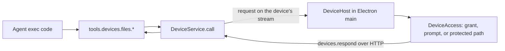

# Local devices

The workspace agent can use the person's own computers. Every computer running the Halo desktop app connects to its workspace as a **device** automatically; nothing is shared until the person answers an access prompt. The agent loop, threads, and state stay on the workspace server; only device tool calls run on the computer.

Status: the workspace protocol and the agent file tools are implemented. The reusable device host and the desktop app land in the next two changes. Local bash and local computer use are planned.

## System flow

## How a device connects

- Electron main starts `LocalDevice`, which reads `device.json` from app data and starts a `DeviceHost` (`apps/electron/src/main/device/LocalDevice.ts`).
- On a new install the device is enabled with no grants. While enabled, `DeviceHost` opens its own workspace socket with a fresh client ID and calls `devices.serve` with its advertisement: ID, name, platform, and home folder (`packages/device-host/src/DeviceHost.ts`).
- The device uses the same workspace connection as the renderer: the local renderer token in development, or the Better Auth bearer token through the control-plane gateway in production. The gateway needs no device-specific route.
- `devices.serve` is an event stream of `DeviceRequest`s. The device answers each with `devices.respond`, which always uses HTTP because file bodies can be large (`packages/client/src/createHaloClient.ts`).
- The workspace CLI cannot serve a device; `devicesRouter` refuses CLI connections (`packages/workspace-server/src/devices/devicesRouter.ts`).
- The device reconnects with backoff after a lost connection, including the server's 55-minute socket limit. Turning the device off or renaming it reconnects; grant changes apply without reconnecting.

## Routing and failures

- `DeviceService` keeps devices by ID and resolves a name or ID per call (`packages/workspace-server/src/devices/DeviceService.ts`).
- An offline device fails at once with `DeviceOfflineError`.
- A disconnect keeps pending calls for 20 seconds so a reconnecting device can still answer. After that they fail with `DeviceDisconnectedError`; the result is unknown and nothing is replayed.
- Calls time out after 5 minutes with `DeviceTimeoutError`, leaving time to answer an access prompt.
- Device errors reach the agent with their code, for example `access_denied` or `read_only`.

## Agent tools

Exec-only tools under `tools.devices` (`packages/workspace-server/src/devices/deviceTools.ts`):

| Tool                                    | Capability                                    |
| --------------------------------------- | --------------------------------------------- |
| `devices.list`                          | `devices.list`                                |
| `devices.files.list`, `read`            | `devices.files.read`                          |
| `devices.files.write`, `edit`, `delete` | `devices.files.write`                         |
| `devices.files.copyToWorkspace`         | `devices.files.read`, `workspace.files.write` |
| `devices.files.copyFromWorkspace`       | `workspace.files.read`, `devices.files.write` |

Every call names its device. Paths may be absolute, `~/`, or relative to the device's home folder. Text reads and edits reuse the workspace file helpers through the `TextFiles` interface. Transfers are limited to 8 MiB.

Shared apps get no device tools, and extensions cannot call them (`extensionToolPolicy.ts`).

## What the device allows

The device decides; the workspace cannot widen its answers (`packages/device-host/src/DeviceAccess.ts`):

- **Enabled:** on by default. The person can turn the computer off in Account settings.
- **Grants:** the first time the agent uses a folder without a grant, Electron shows a native prompt: Allow read and write, Allow read only, or Don't allow (`apps/electron/src/main/device/LocalDevice.ts`). A file request asks about its parent folder; a listing asks about the folder itself. Grants cover subfolders and are saved in `device.json`.
- **Refusals:** remembered until the app restarts or the grants change, so the agent cannot prompt repeatedly. Concurrent requests for one folder share a prompt. An unanswered prompt closes after 4 minutes and refuses.
- **Real paths:** requests and grants resolve through symlinks, so a link inside an allowed folder that points elsewhere asks about its real location.
- **Protected paths:** credential folders under home, such as `~/.ssh`, `~/.aws`, and `~/Library/Keychains`, are refused without a prompt.

The **This computer** section of the account dialog shows the connection, the on/off switch, and the allowed folders with Remove (`packages/web/src/sidebar/DeviceSettings.tsx`).

## Tests

- `packages/device-host/src/DeviceFiles.test.ts`: prompting once per folder, shared prompts, remembered refusals, read-only answers, symlinks, protected paths, and failed prompts.
- `packages/workspace-server/src/devices/DeviceService.test.ts`: delivery, reconnect grace, timeout, and responder checks.
- `packages/workspace-server/test/devices.spec.ts`: a real `DeviceHost` against a real workspace server.
- `apps/electron/e2e/device.e2e.test.ts`: the computer is connected without setup; the agent's read prompts once; the answer appears in settings; turning the computer off disconnects it.

## Next

1. Local bash: `devices.shell.run` with its own on/off setting.
2. Local computer use: run `ComputerService` on the device with the OpenSky driver.
3. A composer reference for local files (`local://<device>/<path>`).
