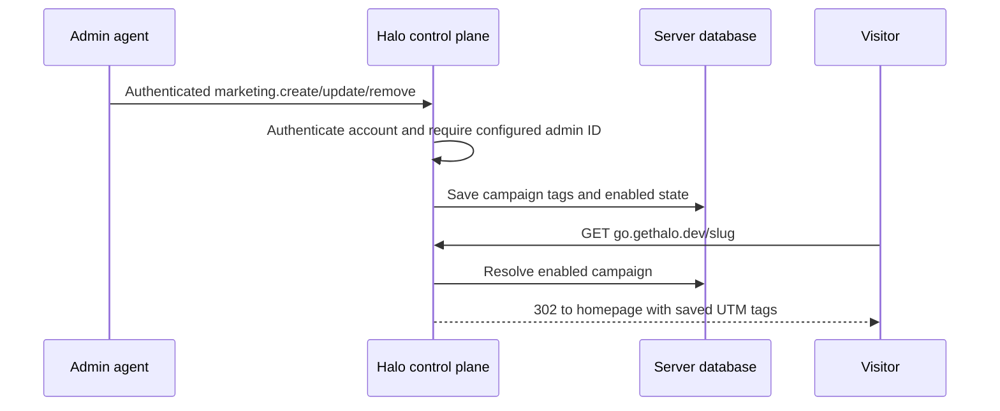

# Persistent marketing campaigns

Campaigns belong to Halo's normal control plane. Agents must manage them without
editing deployment configuration, and visitors must always land on the homepage.
PRs #553 and #554 supply direct host routing and existing wildcard ingress/TLS;
the superseded extension HTTP/custom-domain PRs #543–545 are closed unmerged.

The control plane owns one campaign table in its existing server database. An
explicit deployment-configured set of Halo user IDs authorizes management. No
configured administrators means no management access. Browser sessions use the
primary origin; workspace agents authenticate through their owner's runtime.



Goals: persistent campaign CRUD, server-enforced admin authorization, immediate
updates and disabled links, homepage-only redirects, and agent API documentation.
No management UI, custom domain registry, extension handler, arbitrary destination
URL, click analytics database, or new authentication credentials are introduced.
The existing landing page owns Google Analytics and conversion attribution.

## ✅ Phase 1: Campaign database and admin API

**Today:** Campaigns are deployment configuration. Changing a link needs a rollout.

**Proposed:** Add `marketing.create/list/update/remove` on the normal control-plane
RPC surface. Store a unique slug, five UTM fields and enabled state. Borrow the
same SQL owner/transaction queue as app storage rather than opening another
connection or maintaining a second queue. PostgreSQL and SQLite use the same SQL.
The public resolver remains configured until phase 2 connects the database.

```callstack
 Admin agent
 └── controlPlaneRpcRouter
+    ├── authenticated account or owner workspace identity
+    └── MarketingLinks [[campaign-store:new:49-60]] # explicit admin ID authorization before each operation
+        └── DatabaseService.appDatabase # shared SQL queue and connection
```

## Phase 2: Resolve persistent campaigns

**Today:** The go hostname reads a static map of slug-to-UTM tags.

**Proposed:** Query enabled campaigns on each GET/HEAD. Return 404 for missing or
disabled links, 405 for other methods and 500 on database failure. Preserve raw
path validation, ignore visitor target/tag overrides and prevent private routes
or WebSockets on the marketing host. Remove campaign-map configuration from the
server and Pulumi; only the administrator list remains deployment configuration.
No live links exist in the supplied production map, so no data import is needed.

## References

- [[apps/control-plane/src/marketing/MarketingLinks.ts]]
- [[apps/control-plane/src/marketing/serveMarketingLink.ts]]
- [[apps/control-plane/src/server/controlPlaneRpcRouter.ts]]
- [[packages/shared/src/marketingCampaign.ts]]
- [[apps/control-plane/README.marketing-links.md]]

## Phase 1 source patch

```source-diff:campaign-store:apps/control-plane/src/marketing/MarketingLinks.ts
diff --git a/apps/control-plane/src/marketing/MarketingLinks.ts b/apps/control-plane/src/marketing/MarketingLinks.ts
new file mode 100644
index 00000000..6a628d37
--- /dev/null
+++ b/apps/control-plane/src/marketing/MarketingLinks.ts
@@ -0,0 +1,141 @@
+// oxlint-disable unicorn/no-null -- SQL rows and bindings represent missing optional tags with NULL.
+import type { MarketingCampaign } from "@get-halo/shared/marketingCampaign";
+import * as errore from "errore";
+import type { SqlDatabase } from "../database/SqlDatabase.js";
+
+export class MarketingAdminRequiredError extends errore.createTaggedError({
+  name: "MarketingAdminRequiredError",
+  message: "Marketing links require Halo administrator access.",
+}) {}
+export class MarketingLinkConflictError extends errore.createTaggedError({
+  name: "MarketingLinkConflictError",
+  message: "This marketing slug is already in use. Choose another slug.",
+}) {}
+export class MarketingLinkNotFoundError extends errore.createTaggedError({
+  name: "MarketingLinkNotFoundError",
+  message: "Marketing link not found. List the links to check the slug.",
+}) {}
+
+type CampaignRow = {
+  slug: string;
+  utm_source: string;
+  utm_medium: string;
+  utm_campaign: string;
+  utm_content: string | null;
+  utm_term: string | null;
+  enabled: number;
+};
+
+/** Server-owned campaigns; public resolution never receives admin authority. */
+export class MarketingLinks {
+  private readonly database: SqlDatabase;
+  private readonly adminUserIds: ReadonlySet<string>;
+
+  constructor(ctx: { database: SqlDatabase; adminUserIds: string[] }) {
+    this.database = ctx.database;
+    this.adminUserIds = new Set(ctx.adminUserIds);
+  }
+
+  async initialize() {
+    return await this.database
+      .query(`CREATE TABLE IF NOT EXISTS marketing_links (
+      slug TEXT PRIMARY KEY, utm_source TEXT NOT NULL, utm_medium TEXT NOT NULL,
+      utm_campaign TEXT NOT NULL, utm_content TEXT, utm_term TEXT,
+      enabled INTEGER NOT NULL DEFAULT 1 CHECK (enabled IN (0,1)))`);
+  }
+
+  async create(input: {
+    ownerUserId: string;
+    slug: string;
+    tags: MarketingCampaign["tags"];
+  }) {
+    if (!this.adminUserIds.has(input.ownerUserId))
+      return new MarketingAdminRequiredError();
+    const { slug, tags } = input;
+    const rows = await this.database.query<CampaignRow>(
+      `INSERT INTO marketing_links
+      (slug, utm_source, utm_medium, utm_campaign, utm_content, utm_term, enabled)
+      VALUES ($1,$2,$3,$4,$5,$6,1) ON CONFLICT (slug) DO NOTHING RETURNING *`,
+      // SQL bindings represent optional campaign fields with NULL.
+      // oxlint-disable-next-line unicorn/no-null
+      [
+        slug,
+        tags.utm_source,
+        tags.utm_medium,
+        tags.utm_campaign,
+        tags.utm_content ?? null,
+        tags.utm_term ?? null,
+      ],
+    );
+    if (rows instanceof Error) return rows;
+    if (rows[0] === undefined) return new MarketingLinkConflictError();
+    return campaign(rows[0]);
+  }
+
+  async list(ownerUserId: string) {
+    if (!this.adminUserIds.has(ownerUserId))
+      return new MarketingAdminRequiredError();
+    const rows = await this.database.query<CampaignRow>(
+      "SELECT * FROM marketing_links ORDER BY slug",
+    );
+    if (rows instanceof Error) return rows;
+    return rows.map(campaign);
+  }
+
+  async update(input: MarketingCampaign & { ownerUserId: string }) {
+    if (!this.adminUserIds.has(input.ownerUserId))
+      return new MarketingAdminRequiredError();
+    const { slug, tags, enabled } = input;
+    const rows = await this.database.query<CampaignRow>(
+      `UPDATE marketing_links SET utm_source=$2, utm_medium=$3, utm_campaign=$4,
+      utm_content=$5, utm_term=$6, enabled=$7 WHERE slug=$1 RETURNING *`,
+      // oxlint-disable-next-line unicorn/no-null -- SQL bindings represent missing optional tags with NULL.
+      [
+        slug,
+        tags.utm_source,
+        tags.utm_medium,
+        tags.utm_campaign,
+        tags.utm_content ?? null,
+        tags.utm_term ?? null,
+        enabled ? 1 : 0,
+      ],
+    );
+    if (rows instanceof Error) return rows;
+    if (rows[0] === undefined) return new MarketingLinkNotFoundError();
+    return campaign(rows[0]);
+  }
+
+  async remove(input: { ownerUserId: string; slug: string }) {
+    if (!this.adminUserIds.has(input.ownerUserId))
+      return new MarketingAdminRequiredError();
+    const rows = await this.database.query<{ slug: string }>(
+      "DELETE FROM marketing_links WHERE slug=$1 RETURNING slug",
+      [input.slug],
+    );
+    if (rows instanceof Error) return rows;
+    if (rows.length === 0) return new MarketingLinkNotFoundError();
+  }
+
+  async resolve(slug: string) {
+    const rows = await this.database.query<CampaignRow>(
+      "SELECT * FROM marketing_links WHERE slug=$1 AND enabled=1",
+      [slug],
+    );
+    if (rows instanceof Error) return rows;
+    return rows[0] === undefined ? undefined : campaign(rows[0]).tags;
+  }
+}
+
+function campaign(row: CampaignRow): MarketingCampaign {
+  return {
+    slug: row.slug,
+    tags: {
+      utm_source: row.utm_source,
+      utm_medium: row.utm_medium,
+      utm_campaign: row.utm_campaign,
+      utm_content: row.utm_content ?? undefined,
+      utm_term: row.utm_term ?? undefined,
+    },
+    enabled: row.enabled === 1,
+  };
+}
```
